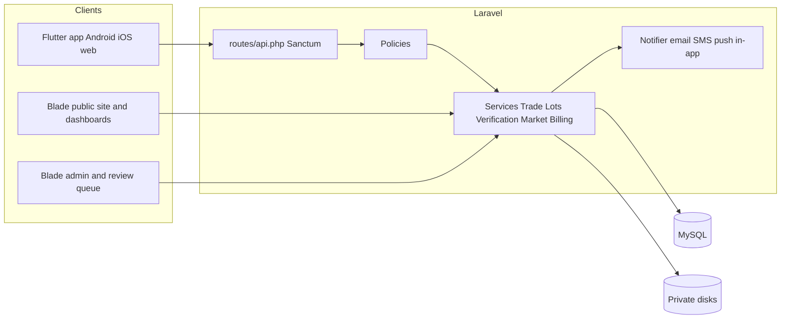
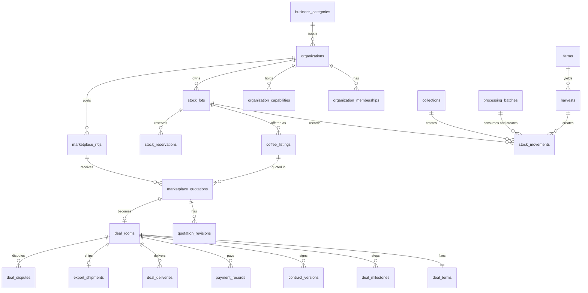
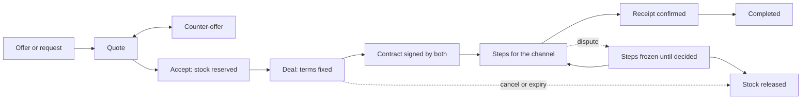

# Coffee B2B Marketplace — audit and integration assessment (2026-11-25)

Read-only audit at commit `4f36602`. No application code, migration, configuration, database or server was changed.
The production server was not contacted, so nothing here describes production state.

**How to read the evidence labels**

| Label | Meaning |
|---|---|
| **[run]** | Proven by running it: real API requests against a throwaway database |
| **[code]** | Read in the source, not executed |
| **[proposal]** | A recommendation that needs your approval |
| **[confirm]** | A business or legal rule that only you or the industry can confirm |

Laravel paths are relative to `firalink web/firalink/`, Flutter paths to `firalink flutter/lib/`.

## Status update 2026-11-26

Done in the working tree, not committed, not deployed:

| Item | Change |
|---|---|
| Release 0, tests | `phpunit.xml` forces an in-memory database (the dev database is never touched); `ResetCoursesCatalogTest` no longer rebuilds the database; export document tests use a fake disk; `/styleguide` added to the public allow-list. `php artisan test`: 401 pass, 2 skipped, 0 fail |
| Release 0, deploy | `scripts/deploy_lms_production.py` rewritten: code only by default, stops when migrations are pending unless `--migrate` and a typed backup confirmation, known host keys only, rollback archive, no `storage/`, `tests/`, `.env` or root scripts, stops on the first failure, `--dry-run`. App deploy script: known host keys only, stops on failure |
| Release 0, keys | `scripts/*` ignored by git except the two deploy scripts. The keys in those files still need rotating |
| D2, D4 | Deal rooms open only from an accepted quote; value and incoterm come from the quote |
| D3, D6 | Contract file locked after the first signature; only owner or manager signs |
| D7 | Dispute freezes signing, proof, confirmation and completion; closed or already disputed deals cannot be disputed |
| D8, D9 | Editing a lot keeps taken bags; CSV import maps real columns, converts USD/kg, rejects bad rows |
| D11 (deposit), D12, D13 | `DEAL_DEPOSIT_PERCENT` applied; web price check uses published lists only; admin activation follows publish rules and is audited |

| D1, D11 (minimum order) | Accepting a quote holds its bags under a row lock; signed deals keep them; unsigned deals release them after 7 days (decision Q6) |
| D5 | Admin deal screen: confirm the current step with a bank reference, decide disputes, cancel deals (fresh confirmation required) |
| D10 | Lots are visible only with an approved ECTA exporter certificate (decision Q2a) |

Decisions behind D1, D5 and D10: `docs/product/07_coffee_b2b_decisions.md`. Still open: D14, D15, release 2 onward;
finance users have no web access yet (admins confirm on the web, finance via the API).

---

## 1. Current project understanding

### 1.1 Main finding

**Fira Link already has a coffee B2B marketplace.** Verification tiers, lots with reviewed evidence, requests and
quotes, samples with seal IDs, deal rooms, business chat, reports and blocks, payout accounts, 30 export document
templates and an app in English and Amharic are built and tested. It covers much of Parts 4.3 and 5 of the brief.

It was designed for one path only: **a verified exporter sells bagged green coffee in USD per pound to a foreign buyer.**
The brief needs three things this design does not have:

1. **More than four kinds of business.** A business has exactly one role: exporter, supplier, broker or buyer
   (`app/Support/BusinessRole.php`). Alami, Akrabi, unions and processors cannot be expressed.
2. **Local trade.** Everything is USD/lb, 60 kg bags, incoterms and ports. There is no ETB, feresula or quintal pricing.
   An exporter or supplier cannot post a purchase request at all.
3. **Stock.** There is no inventory. The same coffee can be sold any number of times (section 7, D1).

The right project is therefore to **repair and extend** the existing marketplace, not to build another one.

### 1.2 Technology

| Area | What is there |
|---|---|
| Backend | PHP 8.2+, Laravel 12, Eloquent; 907 routes, of which 326 are API; 141 tables after all migrations |
| Web | Blade and Bootstrap on the public site, Tailwind 4 through Vite on some pages, a separate admin theme |
| Mobile | Flutter (Dart 3.9), `provider` state, `http` client, package name `eduex_app`; also built for web |
| Auth | Fortify sessions (web), Sanctum tokens (API), phone OTP, email, staff two-factor, "confirm it is you" step |
| Access control | Spatie roles (admin, instructor, student, finance, reviewer), 15 policies, business membership (owner, manager, staff) |
| Database | MySQL 8 is the documented production database. Local and tests use SQLite |
| Files | `public` disk, and private disks `verification` and `export_docs`; real-file checks in `PrivateDocumentStore` |
| Integrations | Chapa, SMS Ethiopia, Firebase push, Gemini (behind flags), ICO and API Ninjas market sources, DomPDF, PhpSpreadsheet |
| Tests | PHPUnit (394 tests) and Flutter (197 tests) |
| Deployment | `scripts/deploy_lms_production.py` and `deploy_app_production.py`: a tar over SSH to cPanel hosting (not a VPS setup) |

### 1.3 Architecture

### 1.4 Modules

| Module | Main code | State |
|---|---|---|
| Accounts, workspaces, team seats | `OrganizationController`, `organizations`, `organization_memberships` | Working |
| Verification tiers 0–3, Fira ID, review queue | `app/Services/Verification/*`, `config/verification.php` | Working |
| Lots, evidence photos, computed lot level | `SellerLotController`, `app/Services/Lots/*` | Working; stock and CSV import broken |
| Requests and quotes | `TradeService`, `MarketplaceRfqController` | Working; no counter-offers |
| Samples and seal IDs | `SampleService` | Working; paid samples switched off |
| Deal room | `DealRoomController`, `DealRoomService` | Partial: see D2–D8 |
| Business chat, contact detection, blocks, reports | `TradeChatService`, `TrustReportService` | Working |
| Payout accounts | `PayoutAccountService` | Working |
| Export document studio, 30 templates | `ExportDocsApiController`, `export_shipments` | Working; not linked to deals |
| ECTA minimum prices | `PriceReferenceService`, `coffee_minimum_price_*` | Working; web uses a different, weaker rule (D12) |
| Market data and Fira AI answers | `app/Services/Market/*` | Working; sources off until approved |
| Plans and quotas | `EntitlementService`, `plans`, `features` | Working |
| Notifications catalogue | `app/Services/Notifications/*` | Slices 1–3 of messaging done; trade events still use the older `TradeUpdate` |
| Academy, events, tours | courses, events, tours | Outside this scope; must not change |

### 1.5 Interface

- **Mobile** is the complete client: 27 marketplace screen files, 6 deal room screens, workspace switcher, team seats.
- **Web** has a public catalogue, suppliers directory, verification centre and one user dashboard
  (`resources/views/marketplace/dashboard.blade.php`). That dashboard reads records by *person* (`seller_id`, `buyer_id`),
  while the API reads them by *business*. The two can show different data.
- **Admin web** has the review queue, sellers, listings, RFQs, subscriptions, ECTA prices and market sources.
  **There is no admin screen for deal rooms, payment steps or disputes.**
- **Design:** two documented systems. Mobile uses `context.fira` tokens and Montserrat. Web uses
  `docs/design/system.md` v2.0 with Inter. Both use #6D1A95. New screens must use these and add no colors, fonts or radii.
- There are 54 flow boards. **None covers a farmer, supplier buying, cooperative, processor or delivery screen**, so the
  content of those screens must come from the business answers in section 8.

### 1.6 Test baseline

| Suite | Result |
|---|---|
| Laravel, migrated database plus `RoleSeeder`, `SaasPlanSeeder`, `ExportDocumentTemplateSeeder`, without `ResetCoursesCatalogTest` | 393 run: **389 pass, 2 skipped, 2 fail** [run] |
| Laravel, full suite on a migrated database without those seeders | 57 of 394 fail, because tests assume the reference data exists [run] |
| Flutter `flutter test` | **197 pass** [run] |
| Flutter `flutter analyze` | 28 issues, not triaged [run] |

The 2 real failures are both in `RouteInventoryTest`, the guard against accidentally public routes: `GET /styleguide` is
public but not on the allow-list, and the `{customPage}` entry depends on which pages exist in the database.

---

## 2. Coffee marketplace integration assessment

### 2.1 Reuse as it is

Accounts and sign-in, workspaces, team membership, Fira ID and public seller page, document capture and review queue,
private file storage, evidence photos and lot levels, samples, business chat, blocks, reports, payout account
confirmation, plans and quotas, notification delivery, audit log, market data, export document generation.

### 2.2 Reuse with changes

| Existing | Change needed |
|---|---|
| `organizations.business_role` (one value) | Keep for old app versions. Add a category and a list of capabilities (2.4) |
| `config/verification.php` documents by role | Requirements per capability, managed by admins once confirmed |
| `coffee_listings` | Becomes the *offer*. Add product form, channel, original price and unit, kg quantities, link to stock |
| `marketplace_rfqs` | Allow local requests (ETB, local units, delivery place instead of port and incoterm) |
| `marketplace_quotations` | Revisions and counter-offers; currency and unit; reservation on acceptance |
| `deal_rooms`, `deal_milestones` | Terms copied from the accepted quote; step list per channel; contract versions; cancel and dispute outcome |
| `export_shipments` | Link to the deal; buyer-visible shipment events |
| `MarketplaceService::getFilterTaxonomies()` and lists repeated in 5 places | One admin-managed reference list. The crop year list stops at 2025/2026 today |
| `marketplace_inquiries`, `marketplace_seller_profiles`, web dashboard | Legacy, person-based. Stop writing, move reads to businesses, keep the rows |
| `target_price_usd_per_lb decimal(6,2)` and similar | Two decimals is too coarse for coffee pricing; new price columns use more |

### 2.3 Build new

Stock and reservations; capabilities; units and exchange rates; local trade channel; farms and harvests; collection
(buying from farmers); warehouses; cooperative membership and settlements; processing batches; quality assessments;
deliveries; contract versions; payment records; admin screens for deals, disputes and reference data.

### 2.4 Core design decisions [proposal]

1. **Separate the three questions.** `entity_type` already records the *legal form*. Add *category* (what people call the
   business) and *capabilities* (what it may do). Policies check capabilities only, never the category name.
2. **A capability has a status:** declared → in review → active → expired or suspended. Regulated ones (export) become
   active only through document review. A paid plan never grants one; `TrustIsNeverForSaleTest` already protects this rule.
3. **Offer and stock are different records.** One stock lot can back several offers (local and export). Every change in
   stock is a row in a movement ledger. Available = movements minus active reservations.
4. **The server writes the money terms.** Deal value, unit, currency and incoterm come from the accepted quote.
5. **Kilograms are the base unit.** The seller's original amount, unit and currency are stored unchanged; conversions
   are calculated and labelled as converted, with the rate and its date.
6. **One deal engine, three step templates** (local, wholesale, export) instead of three modules.
7. **No second document system.** Purchase orders, proformas, sales contracts and LC checklists are existing templates
   in the export document studio.

---

## 3. Required screens and pages

**State:** E = exists, M = exists and needs changes, N = new, L = later release. **R** = release (section 9).
`app` routes are Flutter routes or pushed screens; `web` routes are Blade. All signed-in screens also need loading, empty,
error, offline and success states, and text in English and Amharic. **Web dashboards depend on question Q3**: the project
rules currently limit web work to the seller verify page and the admin review screens.

Permission words: *owner*, *manager*, *staff* = business members; *cap:x* = the business has that active capability.

### A. Business registration and verification

| Screen | State / R | Route | Fields or content (details in 4.4) | Actions | Permission |
|---|---|---|---|---|---|
| Intent selection | M / 2 | app `/onboarding/intent` | Add "Produce or supply coffee" | Continue | Signed in |
| Business setup | M / 2 | app `/profile/workspaces/create` → `POST /api/user/organizations` | F1 | Create | Signed in |
| Category and activities | N / 2 | app `/profile/business/activities` | F2 | Save, request a regulated activity | owner |
| Verification dossier | M / 2 | app `/marketplace/verification` | Documents per activity | Upload, withdraw | owner, manager |
| Document capture | E | app, pushed | Pages, number, dates | Scan, submit | owner, manager |
| Public seller page | M / 2 | web `/verify/{firaId}` | Add category and active activities | Share, report | Public |
| Admin review queue | M / 2 | web `/admin/verification-review` | Add an Activities tab | Approve, ask for changes, reject | reviewer with 2FA |

### B. Farmer (Alami)

| Screen | State / R | Route | Fields or content | Actions | Permission |
|---|---|---|---|---|---|
| Farmer home | M / 3 | app seller home, role-aware | Open offers, requests, harvest due, unpaid deliveries | Add harvest, create offer | cap:produce |
| Farms list, add and edit farm | N / 3 | app `/farms`, `/farms/edit` | F8 | Add, edit, archive | owner, manager |
| Harvests | N / 3 | app `/farms/harvests` | F9 | Record, correct (as a new entry) | owner, manager |
| Create supply offer | M / 2 | app `/marketplace/seller/add-lot` | F3, local channel | Save draft, publish | cap:sell_domestic |
| Incoming requests | M / 2 | app `/marketplace/rfqs` | Filter by channel | Quote, decline | Verified seller |
| Buyers, sales, payments | N / 3 | app `/trade/history` | From deals; filters by date, party, status | Open, export | Members |

### C. Supplier (Akrabi)

| Screen | State / R | Route | Fields or content | Actions | Permission |
|---|---|---|---|---|---|
| Supplier home | M / 3 | app seller home | Stock in kg, reservations, requests, payments due | — | cap:aggregate |
| Farmer and supplier directory | N / 3 | app `/sourcing/parties` | F10 and verified businesses | Add contact, invite, request | owner, manager |
| Record a purchase (collection) | N / 3 | app `/sourcing/collections/create` | F11 | Save, print receipt | cap:buy_domestic |
| Stock list and stock lot detail | N / 1 | app `/stock`, `/stock/{id}` | F7, movements, reservations | Receive, adjust with reason, transfer | owner, manager |
| Warehouses | N / 3 | app `/stock/warehouses` | F12 | Add, edit | owner, manager |
| Wholesale market | M / 2 | app `/marketplace`, channel switch | Channel, form, unit, currency filters | Search, save, request | cap:buy_wholesale |
| Post a purchase request | M / 2 | app `/marketplace/rfqs/create` | F4 | Publish, close | cap:buy_* |
| Purchase orders | N / 2 | app `/deals`, "Buying" tab | From deals | Open | Members |

### D. Exporter (all kinds)

| Screen | State / R | Route | Fields or content | Actions | Permission |
|---|---|---|---|---|---|
| Exporter home | M / 2 | app seller home | Add sourcing and shipments | — | cap:sell_export |
| Coffee lots and lot detail | M / 1 | app `/marketplace/seller`, `/marketplace/lot` | Add stock, reservations | Publish, pause | owner, manager |
| Export offer | M / 2 | app `/marketplace/seller/add-lot` | F3, export channel | Publish | cap:sell_export |
| Sample inbox, ship sample | E | app `/marketplace/samples` | Seal ID, photos | Ship | owner, manager |
| Quote builder, revisions | M / 2 | app, pushed | F5 | Send, revise, withdraw | owner, manager |
| Contract | M / 2 | app, pushed from deal | F6, versions, file hash | Upload version, sign | owner, manager (never staff) |
| Export documents | M / 4 | app `/export-docs` | Pre-filled from the deal | Generate, finalise | owner, manager, staff |
| Shipment | N / 4 | app `/deals/{id}/shipment` | F13 | Add event, attach document | Seller side |
| Payments | M / 2 | app payment milestones screen | F14 | Submit proof | Side that owns the step |
| Buyer directory | N / 4 | app `/buyers` | Verified businesses that opted in | Message | cap:sell_export |

### E. Cooperative and union

| Screen | State / R | Route | Fields or content | Actions | Permission |
|---|---|---|---|---|---|
| Members | N / 5 | app and web `/cooperative/members` | F15 | Add, import CSV, deactivate | cap:aggregate, owner or manager |
| Primary cooperatives of a union | N / 5 | `/cooperative/branches` | Links both sides must confirm | Invite, confirm, end | owner |
| Collection | N / 5 | reuse C "Record a purchase" | F11 with member | Save | manager, staff |
| Aggregated supply | N / 5 | stock list grouped by origin and grade | — | Merge lots | manager |
| Settlements | N / 5 | `/cooperative/settlements` | F16 | Calculate, approve, record payment | owner; approver differs from preparer |

### F. Processor

| Screen | State / R | Route | Fields or content | Actions | Permission |
|---|---|---|---|---|---|
| Facility | N / 5 | `/processing/facility` | Warehouse of type facility, methods | Edit | cap:process |
| Batches, batch detail | N / 5 | `/processing/batches` | F17 | Start, record stage, close | manager, staff |
| Quality records | N / 5 | `/quality` | F18 | Add, submit for review | manager, staff |

### G. Buyer (local, wholesale, international)

| Screen | State / R | Route | Fields or content | Actions | Permission |
|---|---|---|---|---|---|
| Buyer home | N / 2 | app home, buyer card | My requests, quotes to decide, samples, deals | — | cap:buy_* |
| Marketplace, filters, saved lots | M / 2 | app `/marketplace` | Channel, form, unit, currency, incoterm | — | Public view; some channels signed in |
| Compare quotes | M / 2 | app, pushed | Converted price per kg, original price, revisions | Accept, counter, decline | owner, manager |
| Request sample, tracking | E | app `/marketplace/samples/tracking` | — | — | cap:buy_export |
| Deal, contract, payments, shipment | M / 2, 4 | as in D | Buyer view | Sign, pay proof, confirm receipt | owner, manager |
| Purchase history | N / 3 | app `/trade/history` | — | Export | Members |

### H. Shared

| Screen | State / R | Notes |
|---|---|---|
| Lot detail | M / 2 | Original price, converted price, available quantity, minimum order |
| Business profile | M / 2 | One profile for seller and buyer; opt-in fields only |
| Negotiation timeline | N / 2 | Offers, counter-offers and messages in order, inside the request |
| Business chat | E | Keep contact detection and warnings |
| Deals list and deal detail | M / 1 | Selling and Buying tabs; step list by channel |
| Delivery | N / 2 | F19; buyer confirms received weight |
| Dispute | M / 1 | Evidence kept separate from payment proof; status and outcome visible |
| Notifications | M / 2 | Move trade events to the catalogue with push |

### I. Administration (web)

| Screen | State / R | Route [proposal] | Permission |
|---|---|---|---|
| Deals, deal detail, confirm payment step | N / 1 | `/admin/trade/deals` | finance, admin, fresh confirmation |
| Disputes: assign, decide, close | N / 1 | `/admin/trade/disputes` | reviewer, admin |
| Categories and capabilities | N / 2 | `/admin/trade/categories` | admin |
| Reference data (F20) | N / 2 | `/admin/trade/reference` | admin |
| Units and conversions (F21) | N / 2 | `/admin/trade/units` | admin |
| Exchange rates (F22) | N / 2 | `/admin/trade/fx-rates` | finance, admin |
| Businesses, sellers, listings, RFQs | M / 1 | `/admin/marketplace/*` | admin. "Activate listing" must use the publish rules and the audit log (D13) |
| Reports: volumes by channel, origin, status | L / 5 | `/admin/trade/reports` | admin; real records only |
| Plans | E | `/admin/saas-billing` | admin |

**Not needed for the first release:** farmer mobile money payouts, automatic bank integration, vessel tracking feeds,
auctions, roasted retail sales, a public API for buyers.

---

## 4. Database and field requirements

### 4.1 Existing entities to reuse

`users`, `organizations`, `organization_memberships`, `verification_documents` and pages, `verification_tier3_grants`,
`coffee_listings`, `coffee_listing_media`, `lot_evidence` and pages, `marketplace_rfqs`, `marketplace_quotations`,
`marketplace_samples`, `deal_rooms`, `deal_milestones`, `trade_conversations`, `trade_messages`, `business_blocks`,
`trust_reports`, `payout_accounts`, `export_shipments` and items, `generated_documents`, `document_templates`,
`coffee_minimum_price_*`, `market_*`, `audit_logs`, `plans`, `features`, `usage_counters`, `notification_*`.

### 4.2 New entities [proposal]

All migrations only add tables or nullable columns. No existing column is dropped, renamed or changed in type.

| Table | Purpose and main constraints | R |
|---|---|---|
| `stock_lots` | Physical coffee owned by one business; kg `decimal(14,3)`; belongs to one organization | 1 |
| `stock_movements` | Append-only ledger: receive, adjust, reserve, release, ship, process in/out; signed kg, reason, source record; unique source key blocks duplicates | 1 |
| `stock_reservations` | Quote or deal holding stock; status held, committed, released; expiry; one active row per quote | 1 |
| `deal_terms` | Terms copied from the accepted quote: quantity, unit, price, currency, incoterm, place, payment term; immutable after both sign | 1 |
| `deal_disputes` | Own record with reason, evidence, status, outcome, decided by (today it overwrites fields on the deal) | 1 |
| `business_categories`, `capabilities`, `category_capability` | Admin-managed, labels in both languages, "legally confirmed" flag | 2 |
| `organization_capabilities` | Capability per business with status, reviewer, valid until; unique per business and capability | 2 |
| `reference_items` | Type, code, label en/am, parent, active, order: regions, zones, woredas, varieties, processes, grades, forms, packaging, certifications, crop years, incoterms, payment terms | 2 |
| `measurement_units` | Code, kg factor, status draft or confirmed, effective date | 2 |
| `fx_rates` | Pair, rate, source, effective date, entered by; no rate means no conversion is shown | 2 |
| `price_tiers`, `price_history` | Bulk prices; append-only changes of an offer's price | 2 |
| `quotation_revisions` | Every offer and counter-offer, by side; only the latest can be accepted | 2 |
| `contract_versions` | File, hash, signatures per version; a new version clears earlier signatures | 2 |
| `deal_deliveries` | Local delivery: sent and received kg, place, receipt | 2 |
| `payment_records` | Instrument (TT, LC, CAD, advance, balance, cash, bank), currency, reference, evidence, confirmation by finance | 2 |
| `warehouses`, `farms`, `harvests` | Operations records of one business | 3 |
| `trade_contacts` | Farmers and traders without accounts; private to one business; consent date | 3 |
| `collections` | Purchase from a farmer or member; creates a stock movement | 3 |
| `shipment_events` | Dated events on an existing `export_shipments` row | 4 |
| `organization_links` | Union and primary cooperative, confirmed by both | 5 |
| `cooperative_members`, `member_settlements` and lines | Members and payments to them | 5 |
| `processing_batches`, `batch_inputs`, `batch_outputs` | Input, output, loss; output creates stock | 5 |
| `quality_assessments` | Moisture, defects, screen, cup score; links to `lot_evidence` for review | 5 |

Added columns: `organizations.business_category_id`; `coffee_listings.stock_lot_id, channel, product_form, quantity_kg,
price_amount, price_currency, price_unit, price_per_kg, price_mode`; `marketplace_rfqs` and `marketplace_quotations`:
`channel, currency, price_unit, quantity_kg, delivery_place`; `deal_rooms.quotation_id` (unique), `channel, currency`;
`export_shipments.deal_room_id`.

Purchase orders need **no** table: the order is the accepted deal, printed with the existing "Purchase Order
Confirmation" template.

### 4.3 Relationships

### 4.4 Field specifications

Columns: **Req** Y = required, P = required to publish or submit, C = conditional. **Show when** is blank if always shown.
Every write permission is owner or manager unless stated. The API key equals the field name; destination is
`table.column` or the table in the form title. Ownership, status, level, tier and confirmation fields are never accepted
from a client.

#### F1 Business setup — `organizations`, `POST /api/user/organizations`

| Field | Type | Req | Default | Validation | Show when |
|---|---|---|---|---|---|
| name | string | Y | | 2–160, exists today | |
| business_category_id | ref | Y | | active category | |
| entity_type | enum | Y | | existing list of 10 | |
| country | ref | Y | Ethiopia | existing list | |
| tin_number | string | N | | 10 digits in Ethiopia, otherwise 4–30 | |
| region, zone, woreda | ref | C | | valid parent chain | country is Ethiopia |
| billing_email | email | N | account email | email | |

#### F2 Activities — `organization_capabilities`, `PUT /api/organizations/{id}/capabilities` (owner)

| Field | Type | Req | Default | Validation | Show when |
|---|---|---|---|---|---|
| capability | ref | Y | from category | allowed for the category | |
| document | file | C | | real PDF or photo, private disk | capability is regulated |
| document_number | string | C | | encrypted | document needs one |
| expires_at | date | C | | future | document expires |
| status | enum | server | declared | review action only | |

#### F3 Coffee offer — `coffee_listings` (+ `stock_lots`), `/api/marketplace/seller/lots`

| Field | Type | Req | Default | Validation | Show when |
|---|---|---|---|---|---|
| title | string | Y | | max 255 | |
| channel | enum | Y | from capability | domestic, wholesale, export; capability active | |
| product_form | ref | P | green | active item | |
| coffee_type | ref | P | arabica | active item | |
| variety | ref | N | | active item | |
| origin_region, zone, woreda | ref | P (region) | | valid parent chain | |
| washing_station, farm_id | string, ref | N | | farm belongs to the business | |
| processing_method | ref | P | | allowed for the form | form is not fresh cherry |
| crop_year | ref | P | current | active item | |
| grade | ref | C | | active item | green; required for export |
| screen_size | string | N | | max 30 | green |
| moisture_content | decimal(4,2) | N | | 5–20 today; a wet-cherry range is [confirm] | not fresh cherry |
| water_activity | decimal(4,2) | N | | 0–1 | green |
| cupping_score | decimal(5,2) | N | | 0–100; shown as claimed until a lab report is approved | green, roasted |
| tasting_notes | list | N | | max 10 items, 40 each | green, roasted |
| defects | integer | N | | per 300 g, 0–500 | green |
| certifications | list of ref | N | | shown as claimed until evidence is approved | |
| evidence photos, lab report | file | N | | existing evidence rules | |
| stock_lot_id | ref | P | | own business, enough available | |
| quantity | decimal(14,3) | P | | > 0, not above available stock | |
| quantity_unit | ref | P | channel default | confirmed unit | |
| minimum_order | decimal(14,3) | P | | > 0, not above quantity | |
| packaging, bag_weight_kg | ref, decimal | C | | bag weight > 0 | packed forms |
| price_mode | enum | Y | negotiable | fixed, negotiable, on request | |
| price_amount | decimal(18,6) | C | | > 0; export checked against ECTA minimum | not "on request" |
| price_currency, price_unit | ref | C | channel default | allowed pair (ETB or USD list in the brief) | not "on request" |
| price_tiers[] | rows | N | | rising quantity, falling price | |
| collection_place, warehouse_id | string, ref | C | | own warehouse | domestic, wholesale |
| delivery_option, lead_days | enum, int | N | pickup | 0–180 days | domestic, wholesale |
| incoterm, named_place | ref, string | C | | both together | export |
| port_of_loading, destination_port | string | N | | max 100 | export |
| payment_terms[] | list of ref | C | | active items | |
| sample_available, sample_cost | bool, decimal | N | false | ≥ 0 | |
| expires_at | date | N | +90 days [confirm] | future | |
| description | text | N | | max 5000, contact detector | |

#### F4 Purchase request — `marketplace_rfqs`, `POST /api/marketplace/rfqs`

| Field | Type | Req | Default | Validation | Show when |
|---|---|---|---|---|---|
| title | string | Y | | max 255, contact detector | |
| channel | enum | Y | | buying capability active | |
| product_form, origin, process, grade | ref | form Y | | active items | |
| min_cupping_score | decimal | N | | 0–100 | export |
| volume_value, volume_unit | decimal, ref | Y | | > 0, confirmed unit | |
| target_price, currency, unit | decimal, ref | N | | > 0 | |
| delivery_place | string | C | | max 150 | domestic, wholesale |
| destination, incoterm | string, ref | C | | active item | export |
| payment_terms | ref | N | | active item | |
| needed_by, closing_date | date | N | +30 days | future | |
| sample_first | bool | N | false | | |
| notes | text | N | | max 3000, contact detector | |

#### F5 Quote and counter-offer — `quotation_revisions`, `POST /api/marketplace/quotes/{id}/revisions`

| Field | Type | Req | Default | Validation | Show when |
|---|---|---|---|---|---|
| listing_id | ref | Y | | own published offer | seller, first offer |
| quantity, unit | decimal, ref | Y | | ≥ minimum order, ≤ available | |
| price, currency, unit | decimal, ref | Y | | > 0; ECTA minimum for export | |
| incoterm, named_place | ref, string | C | from request | both together | export |
| payment_terms, advance_percent | ref, int | N | | 0–100 | |
| ready_date | date | Y | | today or later | |
| valid_days | int | Y | 14 | 1–90 | |
| note | text | N | | max 2000, contact detector | |

#### F6 Contract — `contract_versions`, `POST /api/deal-rooms/{id}/contracts`

| Field | Type | Req | Default | Validation |
|---|---|---|---|---|
| source | enum | Y | generated | generated from terms, or uploaded |
| file | PDF | C | | real PDF, max 10 MB, SHA-256 stored |
| agree | bool | Y | | true, for this exact version |
| signature_name | string | Y | account name | max 255 |
| step-up confirmation | server | Y | | recent "confirm it is you" |

#### F7 Stock lot and movement — `stock_lots`, `stock_movements`, `/api/stock`

| Field | Type | Req | Default | Validation |
|---|---|---|---|---|
| product_form, origin, crop_year, grade | ref | form Y | | active items |
| warehouse_id | ref | N | | own warehouse |
| movement_type | enum | Y | receive | receive, adjust, transfer (others are written by the server) |
| quantity, unit | decimal, ref | Y | | > 0; result never below reserved |
| reason | string | C | | required for adjust, max 255 |
| request_key | uuid | Y | | unique, makes a retry harmless |

#### F8 Farm, F9 Harvest — `farms`, `harvests`

| Field | Type | Req | Validation |
|---|---|---|---|
| farm.name | string | Y | 2–120 |
| farm.region, zone, woreda, kebele | ref, ref, ref, string | region Y | valid parent chain |
| farm.area_ha | decimal(8,2) | N | 0–100000 |
| farm.altitude_min, altitude_max | int | N | 0–4000, min ≤ max |
| farm.varieties | list of ref | N | active items |
| farm.location | point | N | private; never shown without consent |
| harvest.farm_id | ref | Y | own farm |
| harvest.season, harvested_on | ref, date | Y | not in the future |
| harvest.product_form | ref | Y | fresh or dried cherry, parchment |
| harvest.quantity, unit | decimal, ref | Y | > 0; creates one stock movement |

#### F10 Trade contact, F11 Collection — `trade_contacts`, `collections`

| Field | Type | Req | Validation |
|---|---|---|---|
| contact.name, phone | string | name Y | phone encrypted, private to this business |
| contact.kind | enum | Y | farmer, collector, supplier |
| contact.consent_at | date | Y | recorded before saving a phone or location |
| collection.party | ref | Y | contact, member or verified business |
| collection.collected_on, place | date, string | Y | not in the future |
| collection.product_form, quality_note | ref, string | form Y | active item |
| collection.gross, tare, net, unit | decimal, ref | net Y | net = gross − tare when both given |
| collection.price, currency, unit | decimal, ref | Y | > 0 |
| collection.paid_amount, payment_method | decimal, ref | N | ≤ total |
| collection.warehouse_id | ref | N | own warehouse; creates a stock movement |

#### F12 Warehouse, F13 Shipment, F14 Payment record

| Field | Type | Req | Validation |
|---|---|---|---|
| warehouse.name, kind, city, capacity_kg | string, enum, string, decimal | name, kind Y | capacity > 0 |
| shipment.mode, carrier, vessel, voyage | ref, string | mode Y | max 100 |
| shipment.container, seal, bl_number | string | N | container format check |
| shipment.port_loading, port_discharge | string | Y | max 100 |
| shipment.etd, eta | date | N | etd ≤ eta |
| shipment event: kind, date, place, document | ref, date, string, file | kind, date Y | not in the future |
| payment.instrument | ref | Y | TT, LC, CAD or D/P, advance, balance, local bank |
| payment.amount, currency | decimal, ref | Y | > 0; not above the amount outstanding |
| payment.due_date, paid_on | date | N | paid_on not in the future |
| payment.bank_reference | string | C | required when finance confirms, unique per bank |
| payment.evidence | file | C | required with "paid", private disk |
| payment.lc_number, issuing_bank, lc_expiry | string, date | C | instrument is LC |
| payment.status | enum | server | planned, proof submitted, confirmed, rejected; **only finance confirms** |

#### F15 Member, F16 Settlement, F17 Batch, F18 Quality, F19 Delivery

| Field | Type | Req | Validation |
|---|---|---|---|
| member.number, name, phone, kebele, joined_on | string, date | number, name Y | number unique in the cooperative; phone encrypted |
| settlement.period, collections, deductions, net | date range, refs, decimal | Y | each collection settled once; net ≥ 0 |
| settlement.approved_by | server | Y | not the person who prepared it |
| batch.method, started_on, closed_on | ref, date | method Y | started ≤ closed |
| batch.inputs[] stock_lot, kg | rows | Y | ≤ available |
| batch.outputs[] form, grade, kg | rows | to close | sum + loss = input |
| batch.loss_kg, loss_reason | decimal, ref | to close | loss ≥ 0; above a limit needs a reason [confirm] |
| quality.sampled_on, moisture, screen, defects, cup_score, lab | mixed | date Y | ranges as in F3; lab report goes to review |
| delivery.sent_kg, sent_on, place, transporter, plate | mixed | Y | ≤ reserved kg |
| delivery.received_kg, received_on, note | mixed | buyer | difference above tolerance asks for a reason [confirm] |

#### F20 Reference item, F21 Unit, F22 Exchange rate (admin)

| Field | Type | Req | Validation |
|---|---|---|---|
| type, code, label_en, label_am | enum, string | Y | code unique per type and never renamed |
| parent_id, active, sort_order | ref, bool, int | N | no cycles; used items are deactivated, not deleted |
| unit.kg_factor, status, effective_from | decimal(18,8), enum, date | Y | > 0; only confirmed units appear to users |
| fx.base, quote, rate, source, effective_on | ref, decimal(18,8), string, date | Y | > 0; source required; a change is a new row |

---

## 5. User roles and permissions

### 5.1 Capabilities [proposal]

`produce`, `aggregate`, `process`, `sell_domestic`, `sell_wholesale`, `sell_export` (regulated), `buy_domestic`,
`buy_wholesale`, `buy_export` (foreign buyer), `broker` (existing role, kept).

### 5.2 Matrix — every row is [confirm]

✓ = included. R = only after document review. – = no.

| Category in your notes | Produce | Aggregate | Process | Sell local | Sell wholesale | Sell export | Buy local | Buy wholesale | Buy export | Today's role |
|---|---|---|---|---|---|---|---|---|---|---|
| Alami (farmer) | ✓ | – | – | ✓ | – | – | – | – | – | none |
| Alami Laki (farmer-exporter) | ✓ | – | R | ✓ | ✓ | R | – | – | – | exporter |
| Akrabi (supplier) | – | ✓ | – | ✓ | ✓ | – | ✓ | ✓ | – | supplier |
| Akrabi Laki (supplier-exporter) | – | ✓ | – | ✓ | ✓ | R | ✓ | ✓ | – | exporter |
| Union cooperative exporter | – | ✓ | R | ✓ | ✓ | R | members | – | – | exporter |
| Processed coffee exporter | – | – | R | – | ✓ | R | ✓ | ✓ | – | exporter |
| Specialty exporter | – | – | R | – | ✓ | R | ✓ | ✓ | – | exporter |
| General exporter | – | – | – | – | ✓ | R | ✓ | ✓ | – | exporter |
| International buyer | – | – | – | – | – | – | – | – | ✓ | buyer |
| Roaster or distributor | – | – | – | Q | Q | – | Q | Q | ✓ | buyer |

### 5.3 What each side sees

| Record | Own business | Other party in the deal | Other verified business | Public | Staff |
|---|---|---|---|---|---|
| Published export offer | Full | Public fields | Public fields | Public fields (as today) | Full |
| Published local or wholesale offer | Full | Public fields | If it holds the matching buy capability | No [confirm] | Full |
| Stock, warehouses, farms, harvests, collections, members, settlements | Full | No | No | No | Only with a logged reason |
| Purchase request | Full | Quoting seller | Verified seller in that channel | No | Full |
| Quotes and revisions | Own only | Buyer sees all quotes on its request | No | No | Full |
| Deal, contract, payments, deliveries, shipment | Full | Full except private notes | No | No | Full, logged |
| Documents and numbers | Owner, manager | No | No | No | Reviewer |
| Phone, email, person names | Own team | No (business name only, as today) | No | No | Reviewer |

### 5.4 Member roles

Today staff can sign contracts (D6). Proposed: owner and manager sign, accept quotes, publish and reserve; staff record
harvests, collections, batches and prepare documents; only the owner changes payout accounts and activities. Finance
(platform) confirms payments and can never be a party to that deal, which `DealRoomPolicy` already enforces.

---

## 6. Business workflow

### 6.1 One lifecycle

### 6.2 Steps per channel [proposal]

| # | Local supply and domestic trade | Exporter to exporter | International export (today's steps, kept) |
|---|---|---|---|
| 1 | Order confirmed | Contract signed | Contract signed |
| 2 | Advance (optional) | Deposit | Payment secured (deposit or LC opened) |
| 3 | Delivery | Quality check | Pre-shipment inspection |
| 4 | Weight and quality received | Delivery or warehouse transfer | Shipped |
| 5 | Balance paid | Balance paid | Documents released |
| 6 | Closed | Closed | Delivered and confirmed |

| Rule | Local | Wholesale | Export |
|---|---|---|---|
| Currency | ETB | ETB [confirm] | USD, others [confirm] |
| Contract required | Optional above a value [confirm] | Yes | Yes |
| ECTA minimum | No | No [confirm] | Yes, enforced on quote acceptance and contract |
| Sample | Optional | Optional | Yes, if requested |
| Incoterm | No | No | Yes, with named place |

### 6.3 Payment truth

The platform records instruments and evidence. A payment shows as confirmed only after finance enters a bank reference.
The app must never say "escrow": the existing step is stored as `payment_escrow`, but no escrow exists.

---

## 7. Technical risks

### 7.1 Defects in the current marketplace

Fix these before adding features. The new work would sit on top of them.

| # | Severity | Defect | Evidence |
|---|---|---|---|
| D1 | **Critical** | **Overselling.** A 100-bag lot was accepted for 100 bags by three buyers. Available stayed 100. Nothing in the code ever reduces it, and acceptance takes no lock | [run] `TradeService::accept` |
| D2 | **Critical** | **The buyer sets the contract value.** An accepted quote of $60,847.58 became a deal worth $1.00 with a $0.30 deposit. Incoterm "DDP Nowhere" was accepted | [run] `DealRoomController::store` |
| D3 | **Critical** | **A contract can be replaced after the other side signed.** Any participant's upload overwrites the file and the first signature stays. There is no version or hash | [code] `signContract` |
| D4 | High | An **unverified** buyer opened a deal on a **draft** lot with no quote. It skips the tier rule and the ECTA minimum, and can use up the seller's deal quota (2 on the lowest seeded plan) | [run] `store`, listing path |
| D5 | High | **Finance cannot confirm a payment step**: only an API endpoint exists, with no web or app screen. There is also no way to cancel a deal or close a dispute | [code] routes, admin views, app |
| D6 | High | A **staff** member signed for the seller, and a deal became "under contract" with **no contract file** | [run] |
| D7 | High | A payment slip was accepted while the deal was disputed, and a completed deal was reopened by a dispute | [run] |
| D8 | High | Editing a lot sets available back to the total (20 became 100). The app sends that field on every save | [run] `SellerLotController::fields`, `create_lot_screen.dart` |
| D9 | High | Bulk CSV import saves lots with **0 bags and no price** (wrong column names) and silently changes unknown values ("wahsed" → washed, "grade_9" → grade_1). The test checks only the plan limit | [run] |
| D10 | High | Export offers go public at Tier 1. The ECTA exporter certificate is a Tier 2 document, so suppliers, brokers and uncertified exporters can publish export offers. May be intended: see Q2 | [run] |
| D11 | Medium | Minimum order is ignored (1 bag quoted on a minimum of 50). `DEAL_DEPOSIT_PERCENT` has no effect (set to 50, deal got 30), although CLAUDE.md lists it | [run] |
| D12 | Medium | The web lot page states ECTA compliance from any price list, including unpublished ones, with partial matching; the API uses published lists and exact matching | [code] `getOfficialBenchmarkPrice` |
| D13 | Medium | Admin "activate listing" skips verification, completeness and the audit log | [code] `toggleListingStatus` |
| D14 | Medium | Old inquiries store courier accounts and addresses unencrypted, skip the contact detector and blocks, and on web also accept hidden lots. The web dashboard shows buyers' personal names | [code] |
| D15 | Medium | Fixed exchange rates: 120 in `BillingService`, 140 in `CoffeeExportService` | [code] |

### 7.2 Integration and data risks

| Risk | Handling |
|---|---|
| Installed apps call the current API | Keep fields and endpoints; only add. Old fields stay filled from the new ones |
| Existing lots have quantities that were never reduced | Back-fill as **unconfirmed** stock; sellers confirm before new acceptances. Do not guess from past deals |
| Existing deals have client-entered values | Report only; never rewrite. Admin decides each |
| Old roles | Back-fill capabilities that reproduce today's rights exactly, then change rights by admin review |
| Foreign buyers need a TIN certificate, owner ID and bank letter for Tier 1 | Confirm a buyer document set (Q2) before international onboarding |
| SQLite tests, MySQL production | Run migrations and locking tests on MySQL 8 in CI or staging before any release |
| Farmers may have no smartphone, email or documents | Contacts and assisted entry (F10, F11); the minimum identity is Q2 |
| Personal data of farmers and members | Encryption, consent date, access log |

### 7.3 Production and deployment

The current deployment script conflicts with Part 13 of the brief. **Do not use it for this project until it is fixed.**

| Finding | Why it matters |
|---|---|
| Runs `php artisan migrate --force` on every deployment | Part 13 requires review, backup and approval for each migration |
| No backup, maintenance mode, staging or rollback | A failed migration leaves new code on an old schema |
| Prints "FINISHED SUCCESSFULLY" even when commands fail | Breaks "never claim success without checking" |
| Skips `vendor` and never runs `composer install` | A new dependency would break the site |
| Packs local `storage/app`, including 496 private files on this computer (deal, payment and export test files) | Local files are copied into production storage |
| Packs repository root scripts that write to the database when run (`update_company_branding.php`, `fix_local_urls.php`, …) | The root `.htaccess` sends web requests to `public/`, but they should not be on the server |
| Accepts any SSH host key | The server's identity is not checked |
| The migrations have probably been applied by this script, while CLAUDE.md lists the follow-up tasks as not run | The real state of production must be confirmed first (Q5) |

Also open:

- Six untracked files in `scripts/` contain hard-coded key-shaped strings: `list_available_models.py`, `test_bearer.py`,
  `test_generate.py`, `test_model_gen.py`, `test_token_type.py`, `update_server_key.py`. They are not ignored by git, so
  one `git add .` would publish them. `scripts/` is not on the ignore list.
- `enable_gemini_server.py` and `update_server_key.py` switch `GEMINI_ENABLED` on in the server `.env`. CLAUDE.md says to
  keep it off until the leaked key is rotated.
- `phpunit.xml` points at the developer's `database/database.sqlite`, and `ResetCoursesCatalogTest` uses
  `RefreshDatabase`. Running `php artisan test` as documented would rebuild that local database. The local copy already
  has no roles, plans, features or templates.

---

## 8. Clarification questions

Only what the repository cannot answer. Recommended answers are given so you can reply "agree".

**Q1. Business categories.** Are the ten categories in 5.2 the right list, and which are legal licence types rather than
working names? Can one company hold several? *Recommendation: yes to several, through capabilities, with the category as a label only.*

**Q2. Licences and minimum documents.** For each category, which documents allow it to (a) sell locally, (b) sell to
exporters, (c) export? Must an exporter hold the ECTA certificate before its export offers are public (D10)? What is
enough for a farmer and for a foreign buyer? *Recommendation: require the certificate before publishing; farmer = ID and
phone; buyer = company registration, with no Ethiopian documents. Please confirm with ECTA or a lawyer.*

**Q3. Web or mobile.** The project rules limit web to the verify page and admin review, and every other screen to the
app. The brief asks for desktop dashboards. Which applies? *Recommendation: app first for all trading; web dashboards
only for unions, processors and exporters, from release 3.*

**Q4. Measures and money.** Is 1 feresula = 17 kg for every form? What was the 85 kg note (a sack, of what)? Which price
units are normal per product form? May local offers show in USD, or must exporter-to-exporter trade be in ETB? Who enters
exchange rates, and from which source? *Recommendation: keep 85 kg out; local and wholesale in ETB; finance enters the rate with its source.*

**Q5. Production facts.** Which database and version is live? Which migrations have run? Which numbered tasks in CLAUDE.md
are done? Are the leaked keys rotated? Are there real deals, lots or verified businesses? Is there a staging copy and a
tested backup?

**Q6. Reservation rules.** Reserve on quote acceptance (recommended) or on contract? How long before an unsigned deal
releases its stock? *Recommendation: 7 days for export, 48 hours for local.* Are part deliveries allowed, and what weight
difference is acceptable?

**Q7. Fira Link's part in payment and disputes.** Does finance confirm every payment, or only export deals? Who decides
disputes, and with what authority? *Recommendation: export and wholesale confirmed by finance; local confirmed by the seller and labelled that way.*

**Q8. Visibility of local prices.** Should local and wholesale offers be visible only to verified businesses?
*Recommendation: yes.*

---

## 9. Recommended implementation plan

Your order is kept, with one change: **repairs come before new features.** Each release is separate, tested and approved.

| Release | Content | Brief phase | Needs |
|---|---|---|---|
| **0. Safety** | Fix the deployment script, test database setup and route inventory; remove the key-bearing scripts; confirm production state; MySQL test run | 1, 13 | Q5 |
| **1. Make current trade safe** | D1–D9, D11–D14: stock ledger and reservations, terms from the quote, contract versions, dispute record, admin deal and payment screens, CSV import | 5 (part) | Q6 |
| **2. Categories, local trade, negotiation** | Capabilities, reference data, units, rates, channels, purchase requests for all buyers, counter-offers, deliveries, payment records, D10, D15 | 2–5 | Q1, Q2, Q4, Q7, Q8 |
| **3. Sourcing** | Farms, harvests, contacts, collections, warehouses, trade history | 5 | Q3 |
| **4. Export management** | Shipments linked to deals, documents filled from deals, LC, TT and CAD records | 6 | Q7 |
| **5. Cooperatives, processing, quality, reports** | Members, settlements, batches, assessments, traceability | 7 | Q1, Q2 |
| **6. Production preparation** | Permission matrix tests, concurrency tests, migration rehearsal on a copy, app and web regression | 8 | Staging |

### New API endpoints by release [proposal]

| R | Endpoints |
|---|---|
| 1 | `GET/POST /api/stock`, `GET /api/stock/{id}`, `POST /api/stock/{id}/movements`; `POST /api/deal-rooms` (server terms); `POST /api/deal-rooms/{id}/contracts`, `/contracts/{version}/sign`, `/cancel`, `/disputes` |
| 2 | `GET /api/reference`, `GET /api/units`, `GET /api/fx-rates`; `GET/PUT /api/organizations/{id}/capabilities`; `POST /api/marketplace/quotes/{id}/revisions`, `/revisions/{rev}/accept`; `POST /api/deal-rooms/{id}/deliveries`, `/deliveries/{d}/receive`, `/payments` |
| 3 | CRUD `/api/farms`, `/api/harvests`, `/api/warehouses`, `/api/trade-contacts`, `/api/collections`; `GET /api/trade/history` |
| 4 | `POST /api/deal-rooms/{id}/shipment`, `/shipment/events`, `/documents` |
| 5 | `/api/cooperative/members`, `/branches`, `/settlements`; `/api/processing/batches`; `/api/quality` |

Every endpoint gets `auth:sanctum`, a policy, a feature test, and an audit-log row for state changes. Writes that move
stock or money also need a request key, a database transaction and a row lock.

### Tests that must exist before release 1 ships

Two buyers accepting at the same moment; repeat of the same request; reservation expiry; stock never negative; editing an
offer with reservations; deal value equal to the accepted quote; replaced contract clears signatures; disputed deal
refuses proof; a member of another business gets 403 or 404 on every new endpoint; old app payloads still work.

### Rule for each production release

Written migration review, affected tables and row counts, backup taken and restore tested, rehearsal on a copy, your
explicit approval, deploy, then checks of the real result. Rollback is the previous code; added tables and columns stay.

---

## Appendix: what was not checked

- Production server, its database, live site and stores.
- Screens were read in source and tested by the test suites; they were not compared visually on devices.
- MySQL behavior: all runs used SQLite.
- Academy, events and tours were inventoried only.
- Legal rules. Nothing in this report is legal advice, and every category and licence rule is marked [confirm].
