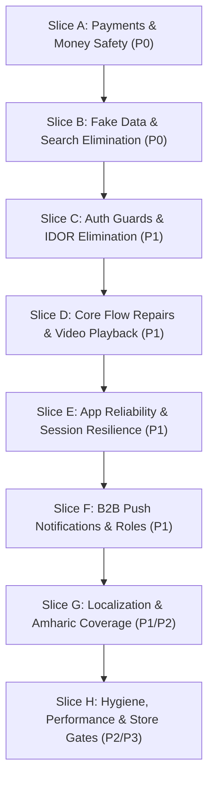

# Detailed Functionality Fix & Gap-Filling Implementation Plan
**Date:** 2026-11-19  
**Target:** Fira Link Full-Stack (Flutter Mobile App, Laravel 12 Backend API, Blade Web)  
**Execution Strategy:** Phased Slices (CLAUDE.md workflow: Backend first -> Flutter UI -> Allowed Blade -> Automated Tests -> Slice Sign-off)

---

## 1. Overview & Slicing Architecture

To bring Fira Link from **"Not Ready"** to a secure, stable, and audit-verified **Production / Beta Release**, we execute the fixes in 8 sequential slices (A through H). Every slice is self-contained, test-driven, and verifiable.

---

## Slice A: Payments Lock-Down & Money Safety (P0)

### 1. Scope & Findings Addressed
- **GAP-001**: Forged billing webhook activates paid subscriptions without payment.
- **GAP-003**: Live Chapa paths running on leaked keys without a server-side kill switch.
- **GAP-009**: Chapa simulated checkout enabled in sandbox mode outside local/testing.
- **GAP-034**: Seller plan verification lacks amount/currency matching.
- **GAP-044**: Null amounts and currency mismatches accepted on booking/course verification.
- **GAP-035**: Attack surface from 9 unused legacy international payment gateways.

### 2. Backend Implementation (`firalink web/firalink/`)
1. **HMAC & Server Verification in Webhooks (`ChapaPaymentAdapter.php` & `BillingService.php`)**:
   - Enforce mandatory HMAC signature validation on `POST /api/billing/webhook/chapa`. If the signature header (`x-chapa-signature` or `Chapa-Signature`) is missing or invalid, abort with HTTP 400/401 immediately.
   - Perform mandatory server-to-server transaction verification (`ChapaClient::verifyTransaction($txRef)`).
   - Match transaction `amount` and `currency` strictly against the database `Invoice` record before updating status.
   - Read the plan directly from the invoice record, never from payload arguments.
   - Return HTTP 404 for unknown payment providers in `BillingService::getProvider()`.
2. **Server-Side Chapa Switch (`CHAPA_ENABLED`)**:
   - Add config `services.chapa.enabled` (`env('CHAPA_ENABLED', false)`).
   - Check `CHAPA_ENABLED` in `ChapaPaymentAdapter::initializePayment()`, `BookingPaymentService`, and course checkout. If disabled, fail closed with localized message: *"Chapa payments are currently unavailable for maintenance. Please pay via offline bank transfer."*
3. **Simulated Checkout Guard**:
   - Guard simulated checkout (`ChapaPaymentAdapter.php:74-81`) with `if (!app()->environment('local', 'testing')) { throw new PaymentException('Live payments required'); }`.
4. **Decommission Unused Gateways**:
   - Disable or remove unused routes for `bkash`, `mollie`, `paypal`, `paystack`, `razorpay`, `sslcommerz`, `stripe`, `xpay` in `routes/api.php`.

### 3. Verification & Tests
- `tests/Feature/BillingWebhookSecurityTest.php`:
  - `test_missing_signature_rejected_with_400()`
  - `test_invalid_signature_rejected_with_401()`
  - `test_unverified_transaction_does_not_activate_subscription()`
  - `test_amount_mismatch_fails_closed()`
  - `test_chapa_disabled_flag_blocks_checkout()`

---

## Slice B: Fake Data & Search Elimination (P0)

### 1. Scope & Findings Addressed
- **GAP-002**: Hard-coded mock lots, prices, and fake "Verified • Tier 2" exporter in `search_screen.dart`.
- **GAP-019**: Default `AdminSeeder` creating `password` accounts without environment checks.
- **GAP-041 & GAP-042**: Simulated AI delays and dead analysis fallbacks.

### 2. Flutter Mobile Implementation (`firalink flutter/`)
1. **Replace Mock Search with Real API Integration (`search_screen.dart`)**:
   - Remove hard-coded mock lot lists (`Sidama Bensa G1 Washed`, `Yirgacheffe Kochere Natural G1`).
   - Remove hard-coded `"Verified • Tier 2"` badge and mock exporter `"Oromia Coffee Farmers Coop Union"`.
   - Wire query input to real API endpoints:
     - Coffee Lots: `GET /api/marketplace/listings?search={query}&per_page=15`
     - Courses: `GET /api/courses?search={query}`
     - Verified Exporters: `GET /api/marketplace/exporters?search={query}`
   - Render real `FiraEmptyState` with localized text when no matches exist.
   - Show shimmer placeholders (`BaseShimmer`) while searching.
2. **Clean Up Mock Delays (`ai_learning_path_screen.dart`, `ai_suggestions_provider.dart`)**:
   - Remove artificial `Future.delayed(Duration(seconds: 2))` pretending to execute AI logic.

### 3. Backend Implementation
1. **Guard `AdminSeeder.php`**:
   - Prevent execution outside `local` and `testing`: `if (app()->environment('production')) { $this->command->error('AdminSeeder cannot run in production'); return; }`.

### 4. Verification & Tests
- `firalink flutter/test/search_screen_test.dart`:
  - Verify zero hard-coded names/prices exist in the widget tree.
  - Test empty search results render real localized empty state.
- `firalink web/tests/Feature/SeederSecurityTest.php`:
  - Verify seeders refuse to seed default passwords in production.

---

## Slice C: Auth Guards & IDOR Elimination (P1)

### 1. Scope & Findings Addressed
- **GAP-004**: Export Docs Studio routes missing `auth:sanctum`, treating app users as guests.
- **GAP-005**: Export readiness assessment crashing with 500 when called by app users.
- **GAP-006**: Public IDOR vulnerability on `/api/org/{id}/entitlements`.
- **GAP-007**: Paid video streaming bypass via arbitrary `lesson_id`.
- **GAP-050**: Unauthenticated document analysis uploads.

### 2. Backend Implementation (`routes/api.php` & Controllers)
1. **Relocate User Routes to `auth:sanctum`**:
   - Move `/api/export-docs/*` (shipments, documents, editor) into `auth:sanctum` route group.
   - Move `/api/coffee-toolkit/assess` and `/api/coffee-toolkit/hub-summary` into `auth:sanctum`.
   - Move `/api/coffee-toolkit/analyze-document` into `auth:sanctum`.
   - Keep public endpoints public: templates, FOB cost calculator formulas, and market prices.
2. **Fix IDOR on Organization Entitlements (`OrganizationEntitlementApiController.php`)**:
   - Require `auth:sanctum`.
   - Enforce that the requesting user is an active member or owner of the organization, or a system admin: abort 403/404 if not authorized.
3. **Fix Video Stream Authorization Bypass (`FileController.php`)**:
   - Query lesson by `video_path`: `$lesson = Lesson::where('video_path', $requestedPath)->firstOrFail();`.
   - Authorize access against the lesson associated with that specific video, rejecting any mismatched `lesson_id`.

### 3. Verification & Tests
- Add feature tests using `withToken($token)`:
  - `ExportDocsStudioAuthTest.php`: Authenticated mobile user can create shipments, view their own list, and receives 401 when unauthenticated.
  - `CoffeeToolkitAssessAuthTest.php`: Validates assessment returns 200 with user scores and persists history.
  - `EntitlementIdorTest.php`: Guest gets 401; non-member user gets 403; member gets 200.
  - `VideoStreamSecurityTest.php`: Free `lesson_id` with paid video path returns 403 Forbidden.

---

## Slice D: Core Flow Repairs & Video Playback (P1)

### 1. Scope & Findings Addressed
- **GAP-008**: Paid self-hosted course video playback failure on mobile.
- **GAP-013**: Unwired "Raise a Dispute" flow in active deal rooms.
- **GAP-011**: Document upload 500s when admin notification mail fails.
- **GAP-016**: Incomplete account deletion privacy/cascade bugs.

### 2. Full-Stack Implementation
1. **Signed URLs for Video Streaming (`StudentCourseController.php` & `course_access_screen.dart`)**:
   - Generate temporary signed URLs (`URL::temporarySignedRoute('api.video.stream', now()->addHours(2), ['path' => $path])`).
   - Mobile `VideoPlayerController` loads the signed URL without needing authorization bearer headers in media players.
2. **Wire "Raise a Dispute" Screen (`dispute_resolution_screen.dart`)**:
   - Add dispute entry point on Deal Room screen (`screens/deal_room/deal_room_screen.dart`) for buyer and seller when milestone is active or in review.
   - Connect form submission to `POST /api/deal-rooms/{id}/dispute` with reason code and evidence attachments.
3. **Isolate Document Review Email (`DocumentReviewService.php`)**:
   - Wrap `VerificationAdminAlert` in `DB::afterCommit()` inside a try/catch block with fallback logging, so mail delivery failure does not roll back or 500 a valid document upload.
4. **Structured Account Deletion (`AccountDeletionService.php`)**:
   - Delete private storage verification files (owner IDs, licences).
   - Anonymize trade counterparty history (retain deal logs for the opposite party while blanking personal PII).
   - Update request status only upon complete database transaction commit.

### 3. Verification & Tests
- Feature tests for signed video URLs, dispute opening, and resilient document upload.
- Flutter widget tests for the deal room dispute button.

---

## Slice E: App Reliability, Session Resilience & Build Gates (P1)

### 1. Scope & Findings Addressed
- **GAP-014**: Lack of centralized 401 session expiration handling; 5xx errors incorrectly wiping tokens.
- **GAP-015**: Unlocalized raw `$e` exception text and missing network timeouts across older services.
- **GAP-033**: Device push token deletion attempted after Sanctum token revocation.
- **GAP-020**: Android release builds falling back to debug signing; missing minimum-app-version gate.

### 2. Flutter Mobile Implementation
1. **Centralized HTTP Interceptor / API Client (`base_service.dart`)**:
   - Standardize request execution through `guardedRequest()` with 15-second connect/receive timeouts.
   - Handle HTTP 401: Clear auth credentials and route user cleanly to Sign-In with localized "Session expired" message.
   - Handle HTTP 5xx / 429: Preserve local session tokens; emit retryable error state instead of logging the user out.
   - Map socket/timeout exceptions to localized, user-friendly copy (`context.l10n.networkError`).
2. **Logout Order Fix (`auth_provider.dart`)**:
   - Unregister device push token with the server *before* revoking the API token.
3. **Build & Version Gate (`build.gradle.kts` & `AppRouter`)**:
   - Throw a build failure if `key.properties` is missing during release APK/AAB build.
   - Add minimum supported version check on app bootstrap via `/api/settings`.

---

## Slice F: B2B Push Notifications & Role Seeders (P1)

### 1. Scope & Findings Addressed
- **GAP-012**: B2B events (quotes, samples, deal steps, document reviews) creating database records without push notifications.
- **GAP-024**: `finance` and `reviewer` roles missing from default seeders.

### 2. Full-Stack Implementation
1. **B2B Notifications Dispatch (`firalink web/`)**:
   - Update `TradeUpdate`, `VerificationUpdate`, and `LotEvidenceUpdate` notification classes to include FCM push delivery.
   - Dispatch push notifications when:
     - Seller receives RFQ or quote acceptance.
     - Buyer receives quote or sample dispatch with tracking code.
     - Deal room milestone is marked paid or confirmed.
     - Seller verification document review status changes.
2. **Flutter Push Routing (`push_notification_service.dart`)**:
   - Map payload type tags (`deal_room`, `sample`, `quote`, `verification`) to corresponding app screens.
3. **Role Seeding (`RoleSeeder.php`)**:
   - Ensure `finance` and `reviewer` roles exist in standard migrations/seeders.

---

## Slice G: Localization & Amharic Microcopy (P1/P2)

### 1. Scope & Findings Addressed
- **GAP-018**: 334 hard-coded English strings across 70 Flutter files; backend responding in English only; incomplete Amharic language files.
- **GAP-036**: Date and timezone display consistency (Africa/Addis_Ababa).

### 2. Full-Stack Implementation
1. **API Locale Middleware (`SetLocale.php` / `routes/api.php`)**:
   - Apply `SetLocale` to API group to respect `Accept-Language: am` and return localized validation and status responses.
2. **Flutter Localization Keys**:
   - Migrate hard-coded text in Lot Details (`coffee_listing_detail_screen.dart`), Auth (`auth_screen.dart`), and Export Studio into `lang_en.dart` and `lang_am.dart`.
   - Verify all keys match via `flutter test test/localization_test.dart`.

---

## Slice H: Hygiene, Performance & Store Gates (P2/P3)

### 1. Scope & Findings Addressed
- **GAP-032**: Course payment verify race condition.
- **GAP-038**: Monolithic file refactoring.
- **GAP-048**: Deprecated Flutter APIs (`withOpacity`, `SharePlus`).
- **GAP-049**: Cleanup of stray test/scratch scripts in repo.
- **GAP-053**: iOS camera permission description in `Info.plist`.

### 2. Implementation
1. Add `lockForUpdate` on course enrollment verification.
2. Replace deprecated `.withOpacity()` with `.withValues()`.
3. Update `Share` calls to `SharePlus.instance.share()`.
4. Delete temporary test files (`TestCase.php.tmp.*`, root diagnostic scripts).
5. Add explicit camera usage justification in iOS `Info.plist` mentioning lot evidence inspection.

---

## Deployment Readiness Checklist

- [ ] **Chapa Key Rotation**: Rotate keys in dashboard; deploy with `CHAPA_ENABLED=false` until verified.
- [ ] **Secret Rotation**: Rotate `APP_KEY`, `GEMINI_API_KEY`, and administrative passwords in production `.env`.
- [ ] **One-Time Tasks**: Execute `php artisan files:move-evidence-private` and reset evidence levels as specified in CLAUDE.md.
- [ ] **Automated Suites**: 100% pass on Laravel SQLite in-memory test suite and Flutter test suite.
- [ ] **Manual QA**: Run `docs/audits/manual-qa-2026-11-19.md` test script on physical Android device.
