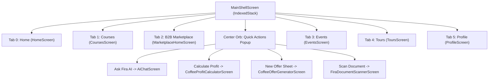

# Fira Link Mobile App: Design System & Tokens Specification

**File Reference:** Part A of the Product Design & Engineering Architecture Specification  
**Platform:** Flutter Client (`firalink flutter`) & Laravel 12 Backend (`firalink web`)  
**Design Reference:** Production Fira Link Design System  

---

## 1. Brand Identity & Color Tokens

All color tokens are extracted directly from `lib/theme/fira_colors.dart` and `lib/theme/app_theme.dart`. The color system uses `ThemeExtension<FiraColors>` to ensure animated runtime switching between Light and Dark modes.

### 1.1 Brand & Neutral Palettes

| Token Name | Light Hex / Value | Dark Hex / Value | Flutter Implementation Reference | Primary Usage |
| :--- | :--- | :--- | :--- | :--- |
| `brandPrimary` | `#6D1A95` | `#8B2BB8` | `AppTheme.primary`, `AppTheme.primaryDark` | Primary buttons, active indicators, brand accents, key CTAs |
| `brandDeep` | `#3B0764` | `#1E0533` | `FiraColors.brandDeep` | Dark purple hero containers, gradient anchors, headers |
| `brandTint` | `#F3E8FF` (`mint100`) | `#2E1065` (`mint100Dark`) | `AppTheme.mint100`, `AppTheme.mint100Dark` | Chip backgrounds, subtle containers, unselected pills |
| `mint200` | `#E9D5FF` | `#3B0764` | `AppTheme.mint200`, `AppTheme.mint200Dark` | Secondary containers, borders, dividers |
| `mint300` | `#D8B4FE` | `#581C87` | `AppTheme.mint300`, `AppTheme.mint300Dark` | Card borders, secondary accents |
| `mint400` | `#C084FC` | `#6B21A8` | `AppTheme.mint400`, `AppTheme.mint400Dark` | Active outlines, highlighted text |
| `surface` | `#FFFFFF` | `#19132B` | `AppTheme.surfaceDark`, `FiraColors.surface` | Cards, bottom sheets, dialogs, form containers |
| `scaffoldBackground` | `#F9F7FA` | `#0F0B1E` | `AppTheme.splashBackground`, `AppTheme.backgroundDark` | Main app scaffold background |
| `softGray150` | `rgb(251, 252, 252)` | `#19132B` | `AppTheme.softGray150` | Card background fallback in course lists |
| `onSurface` / `textDark` | `#1E1B4B` | `#FFFFFF` (`textLight`) | `AppTheme.textDark`, `AppTheme.textLight` | Primary headlines, titles, body text |
| `mutedText` | `#6B7280` (>=4.5:1) | `#9CA3AF` (>=4.5:1) | `FiraColors.mutedText`, `HomeDesignConstants.mutedText` | Captions, secondary labels, helper descriptions |

### 1.2 Semantic & Regulatory Tokens

| Semantic Role | Hex Value | Container Tint | Usage Rules |
| :--- | :--- | :--- | :--- |
| `success` | `#10B981` (Emerald) | `#ECFDF5` | Verified exporter badge, passed inspection, completed milestone, high cupping score (>85) |
| `pending` | `#6D1A95` (Primary Purple) | `#F3E8FF` (Lavender) | **Strict rule:** Pending states use primary purple text on lavender. Amber or green is prohibited for pending items. |
| `danger` / `error` | `#EF4444` (Crimson) | `#FEF2F2` | Rejected documents, expired trade licenses, validation errors, quota exceeded alerts |
| `warning` / `alert` | `#F59E0B` (Amber) | `#FFFBEB` | Off-platform transaction warnings, unverified guest warnings, nearing quota caps |
| `scrim` | `Color(0x800F0B1E)` (50%) | `Color(0xA6000000)` (65%) | Modal barriers, quick action sheet scrim |

### 1.3 Floating Chrome & Glass Tokens

| Token | Light Value | Dark Value | Purpose |
| :--- | :--- | :--- | :--- |
| `dockGradientStart` | `#2A1050` | `#1C0B36` | Floating bottom dock gradient start |
| `dockGradientEnd` | `#14062E` | `#0C031C` | Floating bottom dock gradient end |
| `dockBorder` | `Color(0x33C9A2FF)` (20%) | `Color(0x40C9A2FF)` (25%) | Dock outline glow |
| `glassTint` | `Color(0x1F6D1A95)` (12% purple) | `Color(0x402E1065)` (25% violet) | Liquid glass background layer |
| `glassBorder` | `Color(0x99FFFFFF)` (60% white) | `Color(0x26FFFFFF)` (15% white) | Glass specular highlight stroke |
| `shadowColor` | `Color(0x8C1E0846)` (55% purple) | `Color(0x59000000)` (35% black) | Floating dock & sheet elevation shadow |

---

## 2. Typography

The application strictly defines two font families in `pubspec.yaml`:
1. **Primary Latin Font:** `Montserrat` (Static TTF weights 100 through 900, with italic counterparts).
2. **Fallback Ethiopic Script Font:** `NotoSansEthiopic` (`NotoSansEthiopic-Variable.ttf`), configured in `AppTheme` as `fontFamilyFallback: const ['NotoSansEthiopic']`.

### 2.1 Type Scale

| Style Name | Size | Weight | Line Height | Letter Spacing | Applied Elements |
| :--- | :--- | :--- | :--- | :--- | :--- |
| `displaySmall` | 36px | Bold (700) | 1.20 | -0.8px | Hero splash headings, major stat metrics |
| `headlineLarge` | 32px | Bold (700) | 1.25 | -0.65px | Onboarding headings, modal hero banners |
| `headlineMedium` | 28px | Bold (700) | 1.28 | -0.45px | Screen section titles, Hub headings |
| `titleLarge` | 22px | Bold (700) | 1.30 | -0.3px | App bar titles, dialog titles, lot titles |
| `titleMedium` | 16px | SemiBold (600) | 1.35 | -0.15px | Card titles, subsection labels, tab labels |
| `bodyLarge` | 16px | Regular (400) | 1.42 | -0.1px | Primary descriptions, article body, form text |
| `bodyMedium` | 14px | Regular (400) | 1.42 | 0.0px | Secondary descriptions, list tile subtitles |
| `labelLarge` | 14px | Bold (700) | 1.20 | 0.0px | Button labels, primary CTAs |
| `labelMedium` | 12px | SemiBold (600) | 1.20 | +0.2px | Chip text, badge text, table headers |
| `labelSmall` | 11px | SemiBold (600) | 1.20 | +0.5px | Dock navigation items, micro status pills |

---

## 3. Spatial System, Elevation, Radii & Icons

Defined in `lib/screens/home/widgets/home_design_constants.dart` and `lib/theme/app_theme.dart`.

### 3.1 Radii System

| Token | Radius Value | Applied Components |
| :--- | :--- | :--- |
| `radiusPill` | `999.0px` | Badges, action pills, circular status indicators |
| `radiusDock` | `38.0px` (`34.0px`) | `FiraBottomDock` container, floating navigation shell |
| `radiusDockPill` | `28.0px` (`26.0px`) | Sliding active tab indicator inside `FiraBottomDock` |
| `radiusDialog` | `28.0px` | Material 3 Dialogs (`showDialog`, `AlertDialog`) |
| `radiusBottomSheet`| `28.0px` (top only) | Modal bottom sheets (`showModalBottomSheet`) |
| `radiusHero` | `26.0px` | Top hero marketing banners, major showcase containers |
| `radiusLargeCard` | `24.0px` | Feature cards, detail screen image containers |
| `radiusTile` | `22.0px` | Standard content cards, lot cards, course cards |
| `radiusSearch` | `20.0px` | Search bar containers, floating filter bars |
| `radiusCardTheme` | `18.0px` - `22.0px` | General theme card surfaces |
| `radiusInput` | `16.0px` | Text fields, form inputs, dropdowns |
| `radiusButton` | `16.0px` | Elevated, filled, and outlined action buttons |
| `radiusChip` | `12.0px` | Category filter chips, taxonomy tags |
| `radiusSmallBadge`| `8.0px` | Origin labels, SCA score badges, document status pills |

### 3.2 Spacing & Grid Metrics

- **Horizontal Screen Padding:** `20.0px` standard (`HomeDesignConstants.horizontalPadding`), `16.0px` on compact lists.
- **Card Padding:** `16.0px` standard, `12.0px` compact (lot card).
- **Vertical Section Spacing:** `24.0px` between major sections, `16.0px` between header and content.
- **Bottom Dock Clearance:** `140.0px` (`HomeDesignConstants.bottomDockClearance`) required at the bottom of all scrollable pages so floating dock never obscures content.
- **Floating Dock Height:** `76.0px` dock bar height + `36.0px` raised top center orb = `112.0px` total vertical footprint.

### 3.3 Elevation & Shadows

The app avoids Material 2 harsh drop shadows. Elevation is set to `0` across AppBars, Cards, and Buttons. Depth is rendered via soft directional shadows:
```dart
BoxShadow(
  color: isDark ? const Color(0x99000000) : const Color(0x8C1E0846),
  offset: const Offset(0, 18),
  blurRadius: 36,
)
```

### 3.4 Icon Set & Standard Sizes

- **Primary Icon Package:** `HugeIcons` (`strokeRounded` variants) via `hugeicons: ^1.1.1`.
- **Secondary Icon Package:** `CupertinoIcons` (`cupertino_icons: ^1.0.8`) and `Material Icons`.
- **Standard Sizes:**
  - Micro / Inline badge: `12px` - `14px`
  - Chip avatar / Button leading: `16px`
  - Dock bar navigation items: `20px` - `22px`
  - Section headers / List tiles: `20px` - `24px`
  - Feature hero banners / Empty states: `36px` - `48px`

---

## 4. Reusable Components Catalog

| Component Name | File Path | Visual & Behavioral Description |
| :--- | :--- | :--- |
| `FiraBottomDock` | `lib/widgets/fira_bottom_dock.dart` | Floating rounded capsule dock (gradient `#2A1050` -> `#14062E`), with sliding white pill indicator, animated tab icons, unread badges, and a raised center Orb triggering a modal quick-actions popup. |
| `FiraGlass` | `lib/widgets/fira_glass.dart` | Glassmorphic/Liquid glass container with backdrop blur sigma 24, subtle border highlight, and graceful fallback to solid gradients on Android, Web, and reduced motion. |
| `CourseCard` | `lib/widgets/course_card.dart` | Vertical card (radius 18) with course thumbnail, live badge, bookmark icon, title, difficulty level, and rating. |
| `FeaturedCourseCard` | `lib/screens/home/widgets/featured_course_card.dart` | Horizontal snap-scroll card (236dp width) with cover image, category tag, pricing, rating, and instructor name. |
| `ContinueLearningCard` | `lib/screens/home/widgets/continue_learning_card.dart` | Prominent progress card displaying the active enrolled course, percentage bar, and "Resume" CTA. |
| `MarketplaceLotCard` | `lib/screens/marketplace/marketplace_home_screen.dart:471` | Comprehensive lot card (radius 20) with image preview, Origin badge, SCA score banner (`★ 88.5 SCA`), seller name with verified icon, process/grade badges, available bag count, and indicative FOB price with "View Lot" button. |
| `ToolkitBento` | `lib/screens/home/widgets/toolkit_bento.dart` | Bento grid featuring quick access to FOB Export Calculator, Export Readiness, Offer Sheet Generator, and Daily Market Prices. |
| `MarketStrip` | `lib/screens/home/widgets/market_strip.dart` | Horizontal scroll ticker showing official ECTA regulatory benchmark prices and daily commodity price movements. |
| `HomeSearchBar` | `lib/screens/home/widgets/home_search_bar.dart` | Rounded search input (radius 20) with search icon, clear button, and filter trigger. |
| `TopicChips` | `lib/screens/home/widgets/topic_chips.dart` | Horizontal category selector pills (`All`, `Sourcing`, `Cupping & quality`, `Export docs`, `Logistics`, `Finance`, `Buyers`). |
| `HomeHeader` | `lib/screens/home/widgets/home_header.dart` | Compact header displaying user avatar, greeting, role indicator, notification bell, and unread indicator. |
| `QuotaLimitSheet` | `lib/screens/marketplace/widgets/quota_limit_sheet.dart` | Bottom sheet modal (radius 28) triggered when a seller or buyer reaches plan entitlement limits; shows usage meter and "Upgrade Plan" CTA. |
| `VerificationPromptDialog` | `lib/screens/marketplace/widgets/verification_prompt_dialog.dart` | Alert modal explaining "Trust is Never for Sale" and guiding unverified users to submit compliance dossiers. |
| `AppYoutubePlayer` | `lib/widgets/youtube_player/app_youtube_player.dart` | Cross-platform embedded video player handling YouTube streams for LMS courses and farm tour previews. |
| `LiveClassBanner` | `lib/widgets/live_class_banner.dart` | Live event countdown card with pulsed indicator and "Join Room" button. |
| `HomeSkeletons` | `lib/widgets/home_skeletons.dart` | Shimmer placeholder loading blocks matching the exact dimensions of Home header, hero card, bento grid, and horizontal list. |
| `FiraAiFab` | `lib/widgets/fira_ai_fab.dart` | Floating action button with sparkles icon triggering Fira AI Chat. |

---

## 5. Navigation Architecture & Route Configuration

### 5.1 Dock Navigation (Current App Implementation)

The persistent bottom dock is rendered inside `MainShellScreen` (`lib/screens/shell/main_shell_screen.dart`) with an `IndexedStack` preserving scroll states across tabs:



### 5.2 Routing & Deep Linking Approach

Routing is managed centrally in `lib/router/app_router.dart` using `onGenerateRoute`:
- **Navigator Key:** `AppRouter.navigatorKey` attached to `MaterialApp` in `lib/app.dart`.
- **Route Guards:** `AuthGuard` widget wraps protected routes (e.g. `/dashboard`, `/profile`, `/my-courses`, `/marketplace/seller`, `/export-docs`). Unauthenticated users attempting to navigate to protected routes are redirected to `AuthScreen`.
- **Deep Link Handling:** Standard named route strings (`/marketplace/lot`, `/marketplace/rfqs`, `/coffee-toolkit`, `/export-docs`).

---

## 6. Localization System

- **Supported Locales:**
  1. English (`en`)
  2. Amharic (`am` / አማርኛ)
- **File Architecture:**
  - `lib/l10n/app_en.arb`: Primary localization resource (650+ string keys).
  - `lib/l10n/app_am.arb`: Amharic translation resource.
  - `lib/l10n/app_localizations.dart`: Generated Flutter localization delegate.
  - `lib/l10n/lang_en.dart` & `lang_am.dart`: Fallback map dictionaries.
- **String Retrieval Pattern:** `context.l10n.<stringKey>` using an extension on `BuildContext`.

---

## 7. Design System Observations & Inconsistencies

*(Per Rule 2: Identified for technical clarity without modifying code or rebranding).*

1. **Tab Structure Divergence:** The current codebase implements **6 bottom tabs** (`Home`, `Courses`, `B2B`, `Events`, `Tours`, `Profile`) plus a center Orb menu. The target product vision calls for **5 tabs** (`Home`, `Trade`, `Learn`, `Events` with tours inside, `You`). The 6-tab dock can feel crowded on smaller devices (<360dp width).
2. **Legacy Color Variable Naming:** Color tokens `mint100` through `mint400` in `AppTheme` actually store purple hues (`#F3E8FF`, `#E9D5FF`, `#D8B4FE`, `#C084FC`). This is a historical artifact from an earlier theme revision that was rebranded to Fira Purple.
3. **Mock File Uploads:** `OrganizationVerificationScreen` currently mocks file attachment bytes (`utf8.encode('PDF_CERTIFICATE_DOCUMENT_STREAM_...')`) rather than using real camera/gallery pickers.
4. **Pending State Representation:** While `FiraColors` specifies that pending states must use primary purple text on lavender (`#6D1A95` on `#F3E8FF`), certain older views use amber (`Colors.amber.shade700`).

