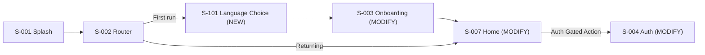
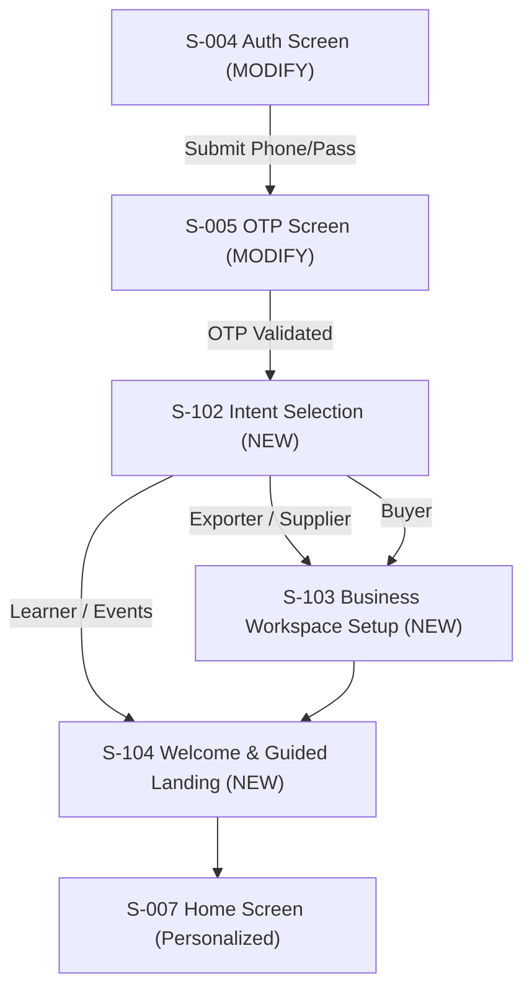
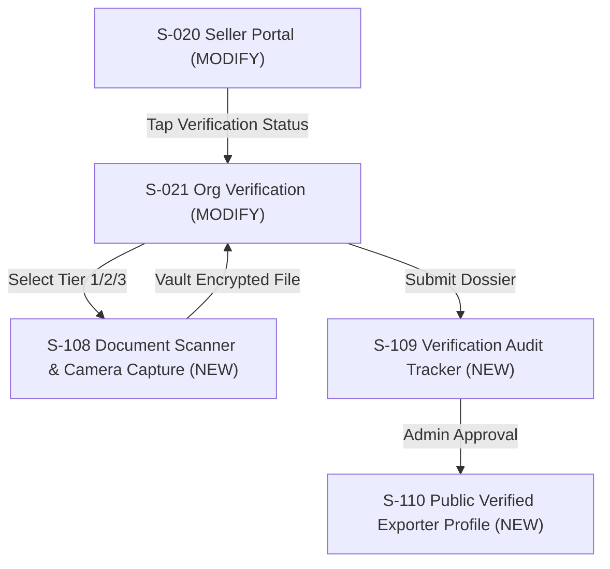
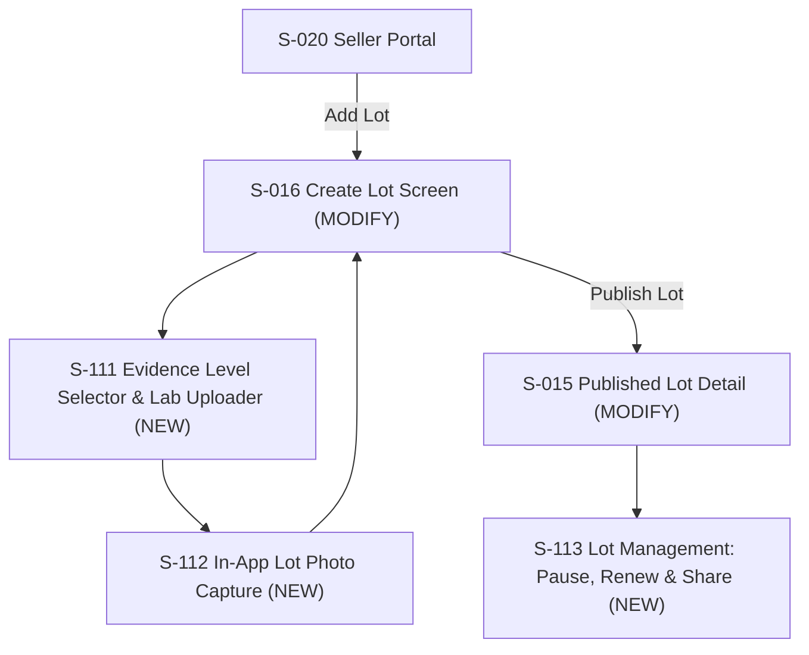
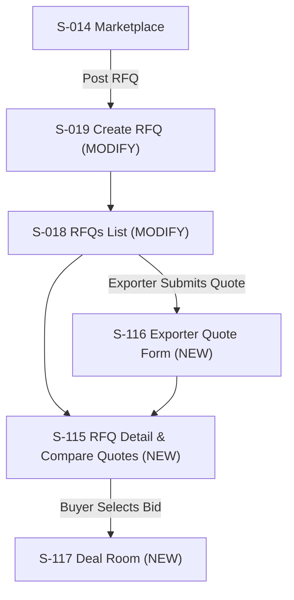
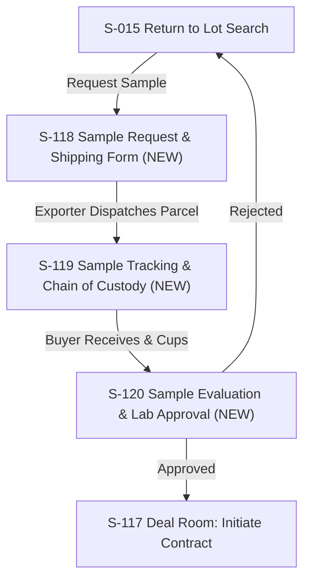
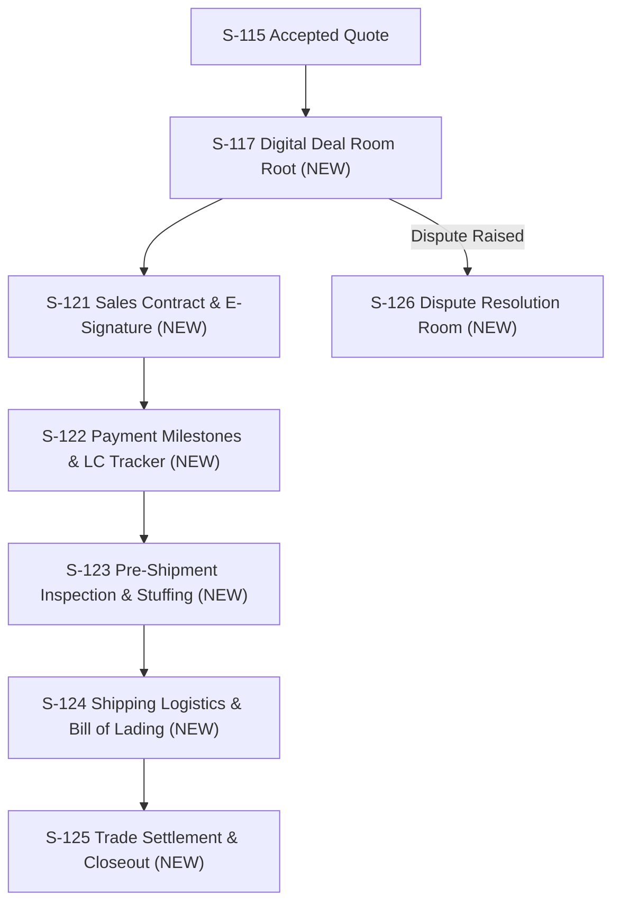

# Fira Link Mobile App: Target Workflows Specification

**File Reference:** Part C of the Product Design & Engineering Architecture Specification  
**App Version:** Target 2.0  
**Status Legend:**
- `EXISTS`: Screen exists in codebase and meets target requirements as-is.
- `MODIFY`: Screen exists in codebase but requires modifications or enhancements.
- `NEW`: Screen is currently missing and must be introduced.
- `REMOVE`: Screen is obsolete, redundant, or orphaned.

---

## Workflow 1: App Launch, Language & Guest Discovery

**Journey Objective:** Allow any user (domestic exporter, international buyer, or student) to launch the app, choose their preferred language, understand the platform value, and immediately explore trade and learning opportunities as a guest without mandatory signup friction.

| Step | Screen ID & Name | Status | Interaction & Business Logic | Transitions |
| :--- | :--- | :--- | :--- | :--- |
| 1.1 | `S-001` Splash Screen | `EXISTS` | Displays animated brand emblem, slogan, and initiates background token validation. | Auto-transitions to S-002 after 2600ms. |
| 1.2 | `S-002` Splash Wrapper Router | `MODIFY` | Checks `SharedPreferences` for `selected_locale` and `has_seen_onboarding`. If first launch, routes to Language Picker. If returning, routes directly to Home. | -> S-101 (if no locale set), -> S-003 (if locale set but !has_seen), -> S-007 (returning guest/user). |
| 1.3 | `S-101` Initial Language Picker | `NEW` | First-run full-screen or bottom sheet prompt allowing instant selection of English or Amharic (አማርኛ). Stores locale in `SettingsProvider`. | -> S-003 Onboarding Carousel. |
| 1.4 | `S-003` Onboarding Carousel | `MODIFY` | 4 high-definition value slides (B2B Trade, Legal Docs Studio, Coffee Agro-Safaris, Global Summits). Add explicit "Explore as Guest" secondary button alongside "Create Account" and "Sign In". | "Explore as Guest" -> S-007; "Create Account" / "Sign In" -> S-004. |
| 1.5 | `S-007` Home Screen (Guest Mode) | `MODIFY` | Renders personalized or guest view. In guest mode, hero displays "Start with Fira Link", market ticker is live, but action CTAs trigger authentication sheet rather than hard wall. | Tap any protected action (RFQ, Sample, Buy) -> S-004. |
| 1.6 | `S-008` Home 2 (Alternative Layout) | `REMOVE` | Dead-end orphaned screen `/home2`. Remove to avoid code divergence. | Deprecated. |

---

## Workflow 2: Phone-First Registration, Intent Selection & Workspace Onboarding

**Journey Objective:** Rapid registration via Ethiopian mobile phone (or international phone/email), verified with SMS OTP, followed by intent-driven onboarding that configures the user's initial workspace without locking their account role.

| Step | Screen ID & Name | Status | Interaction & Business Logic | Transitions |
| :--- | :--- | :--- | :--- | :--- |
| 2.1 | `S-004` Auth Screen | `MODIFY` | Support Phone-first registration with international code selector (+251 default). Email is optional backup. Tab bar toggles between Login and Register. | Submit -> S-005 OTP Screen. |
| 2.2 | `S-005` OTP Verification | `MODIFY` | 6-digit SMS verification. On verification success, store Sanctum token, but DO NOT navigate directly to Home. Route forward to Intent Selection. | Verified -> S-102 Intent Selection. |
| 2.3 | `S-102` User Intent Selection | `NEW` | Presents 4 primary paths: (1) **Export & Sell Commodities** (Coffee Exporter/Cooperative), (2) **Source & Buy Ethiopian Coffee** (International Importer/Roaster), (3) **Learn & Master Trade** (Academy Student), (4) **Attend Forums & Farm Tours** (Delegate/Visitor). Does NOT lock user; simply sets default home experience. | If (1) or (2) -> S-103; If (3) or (4) -> S-104. |
| 2.4 | `S-103` Business Workspace Setup | `NEW` | Optional initial company setup: Company Legal Name, Business Type (Exporter, Commercial Farm, Importer, Broker), Country, and Optional TIN. Includes "Skip for now (Set up later)" link. | "Save Workspace" or "Skip" -> S-104. |
| 2.5 | `S-104` Intent Landing Screen | `NEW` | Tailored welcome screen displaying the primary "First Action" tailored to their intent: Exporters see "Verify ECTA License or Post First Lot"; Buyers see "Create Coffee Sourcing RFQ"; Learners see "Explore Foundational Export Courses". | "Let's Go" -> S-007 Home. |

---

## Workflow 3: Multi-Workspace Switching & Organization Management

**Journey Objective:** Allow users to maintain one unified identity while effortlessly toggling between their Personal Space and one or more verified Business Workspaces (e.g. Exporter entity, Brokerage, Import agency).

| Step | Screen ID & Name | Status | Interaction & Business Logic | Transitions |
| :--- | :--- | :--- | :--- | :--- |
| 3.1 | `S-035` Profile Screen | `MODIFY` | Add top "Active Workspace" switcher pill directly beneath user header (e.g. `🏢 Sidama Horizon Union (Exporter)` vs `👤 Personal Space`). | Tap switcher -> S-105 Workspace Drawer/Modal. |
| 3.2 | `S-105` Workspace Switcher Modal | `NEW` | Bottom sheet listing all workspaces where user is Owner, Manager, or Staff. Displays verification tier badge (`Tier 1 Verified`) next to company name. Includes "➕ Add Business Workspace" action. | Select org -> reloads app context & entitlements; Tap "Add" -> S-106. |
| 3.3 | `S-106` Create Business Workspace | `NEW` | Form to register a new legal trading entity: Company Name, Business Entity Type, Country of Incorporation, Corporate Email, Official Phone. Creates workspace record. | Success -> S-021 Verification Dossier. |
| 3.4 | `S-107` Team Seats & Member Roles | `NEW` | Manage organization team members (Owner, Manager, Staff). Displays seat quota usage based on SaaS plan entitlement. Ability to invite team member via email/phone. | Invite dispatched -> updates members list. |

---

## Workflow 4: Tiered Exporter Verification & Public Ledger

**Journey Objective:** Institutional verification preventing marketplace fraud. Trust is role-specific, tiered, strictly separated from billing, and verifiable by international buyers.

| Step | Screen ID & Name | Status | Interaction & Business Logic | Transitions |
| :--- | :--- | :--- | :--- | :--- |
| 4.1 | `S-020` Seller Portal | `MODIFY` | Prominently displays Exporter Verification Card with status (`Unsubmitted`, `Pending Review`, `Tier 1 Verified`, `Tier 2 Inspected`, `Action Required`). | Tap card -> S-021. |
| 4.2 | `S-021` Organization Verification | `MODIFY` | Replace dummy file upload mock with real multi-tier compliance dossier: **Tier 1 (Legal):** Commercial Reg, ECTA License, TIN, Signatory ID; **Tier 2 (Operational):** Warehouse lease/ownership, washing station GPS; **Tier 3 (Financial):** Bank reference & audited books. | Tap document slot -> S-108. |
| 4.3 | `S-108` Compliance Document Scanner & Camera Capture | `NEW` | Invokes real device camera / gallery / PDF file picker. Automatically crops, runs edge detection, and uploads directly to secure non-public storage. | Document uploaded -> returns to S-021 checklist with "Uploaded (Pending Audit)" state. |
| 4.4 | `S-109` Verification Status & Audit Tracker | `NEW` | Displays timeline of compliance review: Submission timestamp, Auditor notes, "Changes Requested" feedback with inline document re-upload, Approval certificate, and Annual Renewal countdown. | If changes requested -> re-upload in S-108; If approved -> unlocks S-016. |
| 4.5 | `S-110` Public "Verify a Seller" Page | `NEW` | Public lookup page accessible to buyers, customs, and banks: Displays Exporter Legal Name, ECTA License Number, Verification Tier, Verified Date, and Active Listings count. Prevents forged credential scams. | Accessible via QR code or `/verify-seller/{slug}`. |

---

## Workflow 5: Coffee Lot Publishing with Evidence Levels

**Journey Objective:** Exporters publish exportable coffee lots backed by verifiable evidence levels (`Claimed`, `Documented`, `Lab-Backed`, `Inspected`), eliminating phantom listings and misleading claims.

| Step | Screen ID & Name | Status | Interaction & Business Logic | Transitions |
| :--- | :--- | :--- | :--- | :--- |
| 5.1 | `S-016` Create Coffee Lot | `MODIFY` | Expand form beyond basic text fields to include Evidence Level selection, harvest crop year, bagging type (GrainPro + Jute), warehouse city, and sample availability toggle. | Tap Evidence Level -> S-111; Tap Photos -> S-112. |
| 5.2 | `S-111` Evidence Level Selector & Lab Uploader | `NEW` | Four selectable trust tiers: (1) **Claimed** (Self-declared specs), (2) **Documented** (Includes ECTA cupping certificate or washing station receipt), (3) **Lab-Backed** (Accredited Q-grader lab report PDF attached), (4) **Inspected** (Third-party physical inspection at warehouse). Enforces PDF attachment for tiers 2+. | Attaches verified evidence payload -> S-016. |
| 5.3 | `S-112` In-App Lot Photo Capture | `NEW` | In-app camera capture for green beans, parchment, moisture meter readings, and lot bag tags with origin timestamp. Prevents reuse of stock web photos. | Attaches validated photos -> S-016. |
| 5.4 | `S-015` Coffee Lot Detail | `MODIFY` | Display evidence badge with explanatory modal (`Why this lot is Lab-Backed`). Displays ECTA regulatory benchmark comparison and "Share Verified Lot Card" action. | Tap "Share" -> triggers branded lot card sharing image. |
| 5.5 | `S-113` Lot Lifecycle Management | `NEW` | Manage lot states: Active, Under Negotiation, Paused, Sold Out, Expired (90-day auto-expiry). One-tap lot renewal or inventory decrement. | Accessible from S-020 Seller Portal. |

---

## Workflow 6: Buyer Discovery, Search & Seller Inspection

**Journey Objective:** Global green coffee buyers search, filter, and inspect verified Ethiopian lots with transparent regulatory benchmarking, and review exporter trust track records.

| Step | Screen ID & Name | Status | Interaction & Business Logic | Transitions |
| :--- | :--- | :--- | :--- | :--- |
| 6.1 | `S-014` Marketplace Home | `MODIFY` | Add multi-select filter sheet (Origin Region, Processing Method, Grade G1-G5, SCA Cupping Score >=85, Evidence Level, Minimum Bags). Show active filter chips. | Apply filters -> updates lot grid. |
| 6.2 | `S-015` Coffee Lot Detail | `MODIFY` | View high-res bean photos, sensory radar chart, moisture content (9.5-11.5%), water activity, warehouse location, and exporter credibility card. | Tap Exporter -> S-114 Seller Public Profile. |
| 6.3 | `S-114` Seller Public Profile | `NEW` | Public exporter profile displaying: Company Overview, ECTA Export License Tier, Verification Badges, Physical Facility Photos, Completed Export Shipments count, Average Dispatch Time, and All Active Lots. | Tap "Inquire" or "Request Quote" -> S-115. |
| 6.4 | `S-046` Wishlist / Watchlist | `MODIFY` | Separate tabs for "Saved Lots" and "Tracked Exporters". Provides price drop and lot status change notifications. | Tap lot -> S-015. |

---

## Workflow 7: Buyer RFQs & Exporter Quotation Negotiations

**Journey Objective:** International buyers post procurement tenders (RFQs), verified Ethiopian exporters submit structured FOB/CIF bids, and buyers compare quotations side-by-side.

| Step | Screen ID & Name | Status | Interaction & Business Logic | Transitions |
| :--- | :--- | :--- | :--- | :--- |
| 7.1 | `S-018` Marketplace RFQs Screen | `MODIFY` | Separate tabs: "Open Global Tenders" (public) and "My RFQs" (buyer's tenders with response count badges). | Tap RFQ -> S-115. |
| 7.2 | `S-019` Create Buyer RFQ | `MODIFY` | Specify origin, volume bags, target grade, processing, packaging (GrainPro), target delivery window, destination port (e.g. Hamburg, Kobe, Long Beach), and Incoterm (FOB Djibouti, CIF). | Submit -> S-018. |
| 7.3 | `S-115` RFQ Detail & Quotation Comparison | `NEW` | Buyer view displaying all received exporter quotations side-by-side: Price USD/lb, Total FOB Value, Exporter Verification Tier, Sample Dispatch Time, and Validity. Actions: "Accept Quote", "Decline", "Counter-Offer". | "Accept Quote" -> S-117 Deal Room. |
| 7.4 | `S-116` Exporter Quotation Builder | `NEW` | Full-screen quotation builder replacing the compact modal: Calculates FOB price breakdown, validates price against official ECTA minimum threshold, specifies validity days and sample terms. | Submit -> updates quotation status. |

---

## Workflow 8: Green Coffee Sample Pipeline & Sealed Retained Sample Tracking

**Journey Objective:** Protect buyers and sellers from "sample bait-and-switch" scams. Standardizes sample requesting, courier air freight tracking (DHL/FedEx), and digital sealing of the Retained Counter-Sample.

| Step | Screen ID & Name | Status | Interaction & Business Logic | Transitions |
| :--- | :--- | :--- | :--- | :--- |
| 8.1 | `S-118` Sample Request & Dispatch Form | `NEW` | Buyer inputs delivery address, sample weight (250g / 500g), and courier account number (or pays courier shipping fee via Chapa/Card). Exporter accepts and enters courier tracking code (DHL/FedEx). | Submitted -> S-119. |
| 8.2 | `S-119` Sample Tracking & Chain of Custody | `NEW` | Live status pipeline: (1) Sample Requested, (2) Parcel Prepared & Retained Sample Sealed (photo & seal number recorded), (3) Courier Dispatched (tracking link), (4) Delivered, (5) Cupping Evaluation. | Courier delivers parcel -> S-120. |
| 8.3 | `S-120` Sample Evaluation & Approval | `NEW` | Buyer records cupping lab outcome: Cupping Score, Flavor Notes, Acceptance/Rejection decision. If approved, system locks this sample's cryptographic seal hash to the future export contract. | "Approve Sample" -> prompts S-117 Deal Room creation. |

---

## Workflow 9: Secure Deal Room, Milestone Payments & Shipment Updates

**Journey Objective:** Transition agreed deals into an auditable digital deal room with commercial contracts, milestone payment verification, pre-shipment inspection, and bill of lading releases.

| Step | Screen ID & Name | Status | Interaction & Business Logic | Transitions |
| :--- | :--- | :--- | :--- | :--- |
| 9.1 | `S-117` Deal Room Hub | `NEW` | Central collaborative workspace between Buyer and Exporter. Shows Contract Value, Volume (MT / Containers), Current Milestone Progress Bar, Parties, and Activity Log. | Tap milestone -> S-121 to S-125. |
| 9.2 | `S-121` Export Contract & E-Signature | `NEW` | Generated institutional export contract (FOB/CIF terms, incoterms, quality specs matching approved sample seal). Dual e-signature execution. | Signed -> unlocks Milestone 1. |
| 9.3 | `S-122` Payment Milestones & LC Tracker | `NEW` | Tracks international trade finance milestones: (1) Letter of Credit (LC) opened via Ethiopian commercial bank, (2) Advance deposit confirmed, (3) Final payment against shipping documents. Uploads SWIFT MT103 / LC copy. | Milestone confirmed -> unlocks container prep. |
| 9.4 | `S-123` Pre-Shipment Inspection & Stuffing | `NEW` | Warehouse dry mill progress, ECTA pre-export inspection clearance, container stuffing report with seal numbers and photos. | Inspection approved -> S-124. |
| 9.5 | `S-124` Shipping Logistics & Document Release | `NEW` | Addis-Djibouti railway/trucking dispatch, vessel booking, Bill of Lading (B/L) scan upload, Phyto & Origin certificates handover. | Cargo departs port -> S-125. |
| 9.6 | `S-125` Trade Settlement & Review | `NEW` | Buyer confirms receipt of original documents and arrival at destination port. Releases final settlement record, issues mutual trade review, and archives deal to immutable audit ledger. | Completed deal. |
| 9.7 | `S-126` Trade Dispute Resolution Room | `NEW` | In case of weight discrepancy, quality defect, or delayed shipping: formal arbitration filing, evidence upload (lab cupping comparison against sealed retained sample), and arbitrator review. | Resolution reached. |

---

## Workflow 10: Trust & Safety, Scam Prevention & Fraud Reporting

**Journey Objective:** Protect marketplace participants from fraudulent brokers, stolen licenses, and off-platform wire scams.

| Step | Screen ID & Name | Status | Interaction & Business Logic | Transitions |
| :--- | :--- | :--- | :--- | :--- |
| 10.1 | `S-127` Public Seller Verification Tool | `NEW` | Standalone verification lookup tool accessible from Home and Profile: Enter company name or ECTA license number to check active standing, revoked status, or compliance flags. | Displays public audit profile. |
| 10.2 | `S-128` Report Listing or User Modal | `NEW` | Triggered from any lot, quote, or chat: Report categories (Suspected Scam, Fraudulent Documents, Demanding Unsecured Off-Platform Cash Wire, Misrepresented Origin). Requires evidence upload. | Submit -> dispatches high-priority compliance alert. |
| 10.3 | `S-129` Off-Platform Payment & Scam Warning | `NEW` | Interstitial banner displayed whenever a user attempts to share direct wire details or unverified bank accounts in chat or inquiry forms. Warns of trade fraud risks. | User must acknowledge warning to proceed. |
| 10.4 | `S-130` Suspended / Revoked Account State | `NEW` | Gated error screen displayed if an organization's ECTA license expires or is revoked for regulatory non-compliance. Restricts new lots while preserving open deal rooms. | Directs to S-021 for compliance appeal. |

---

## Workflow 11: Export Toolkit & AI Document Studio

**Journey Objective:** Empower Ethiopian coffee exporters with institutional pricing tools, ECTA readiness assessments, official contract offer sheets, and OCR document processing.

| Step | Screen ID & Name | Status | Interaction & Business Logic | Transitions |
| :--- | :--- | :--- | :--- | :--- |
| 11.1 | `S-017` Coffee Toolkit Hub | `EXISTS` | Hub overview linking to FOB Calculator, Offer Generator, Readiness, and Market Prices. | Tap tool -> S-017A through S-017D. |
| 11.2 | `S-017A` FOB & Profit Calculator | `EXISTS` | Interactive costing tool calculating net margins from farmgate cherry to FOB Djibouti port. Generates institutional export cost breakdown. | Tap "Save" -> stores to user profile; Tap "PDF" -> exports summary. |
| 11.3 | `S-017B` Formal Offer Sheet Generator | `EXISTS` | Creates branded export offer sheets conforming to ECTA and European Coffee Federation standards. Generates downloadable PDF. | Download / Share PDF. |
| 11.4 | `S-017C` Export Readiness Assessment | `EXISTS` | 10-step institutional audit scoring exporter readiness (0-100%) with recommendations. | Generates export readiness certificate. |
| 11.5 | `S-017D` Daily Market Prices & Chart | `EXISTS` | Official daily ECTA minimum export prices and ICE Arabica market candlestick charts. | Historical lookup. |
| 11.6 | `S-022` Export Docs Studio | `EXISTS` | Comprehensive enterprise suite with 30 trade templates (Commercial Invoice, Packing List, Phyto, Weight Certificate, Bill of Lading, Certificate of Origin). | Tap template -> S-022A. |
| 11.7 | `S-022A` Export Document Editor | `EXISTS` | In-app document builder with live calculations, AI autofill, and PDF/Excel generation. | Finalize -> stores in vaulted documents. |
| 11.8 | `S-025` Fira Document Scanner | `MODIFY` | Camera OCR scanner for paper export documents: Enhance OCR extraction to validate TINs, customs seals, and weight statements against ECTA rules. | Scanned -> pre-fills S-022A. |

---

## Workflow 12: Fira AI Advisory & Legal Intelligence

**Journey Objective:** Instant trade intelligence, tariff lookups, regulatory compliance advice, and export calculation assistance powered by Google Gemini.

| Step | Screen ID & Name | Status | Interaction & Business Logic | Transitions |
| :--- | :--- | :--- | :--- | :--- |
| 12.1 | `S-024` Fira AI Chat Screen | `MODIFY` | Conversational interface with quick prompts. Enhancements: Display clear badge indicators distinguishing **Verified Regulatory Data** (ECTA official rates, published directives) from **Statistical Estimates** (freight projections, profit forecasts). | Tap suggestion -> auto-populates prompt. |
| 12.2 | `S-131` AI Calculation & Tool Result Card | `NEW` | Interactive widgets embedded directly inside chat bubbles (e.g. In-chat FOB mini-calculator, tariff calculator, EUDR traceability checklist) with "Open in Full Tool" CTA. | Tap "Open in Full Tool" -> S-017A or S-022. |

---

## Workflow 13: Academy Learning, Quizzes & Certification

**Journey Objective:** Practical export education: Course discovery, video masterclasses, interactive quizzes, assignments, and accredited certificate issuance.

| Step | Screen ID & Name | Status | Interaction & Business Logic | Transitions |
| :--- | :--- | :--- | :--- | :--- |
| 13.1 | `S-010` Courses Screen | `EXISTS` | Course catalog with category filters, ratings, and difficulty levels. | Tap course -> S-011. |
| 13.2 | `S-011` Course Detail | `EXISTS` | Syllabus preview, instructor credentials, sample video, reviews, and enrollment CTA. | Enroll -> S-012 Checkout. |
| 13.3 | `S-012` Course Checkout | `EXISTS` | Payment gateway selector (Chapa, Telebirr, CBE Birr, Offline Bank Transfer). | Paid -> S-013 LMS Player. |
| 13.4 | `S-013` Course Access (LMS Player) | `EXISTS` | Video playback, lesson attachments, discussion forum, and lesson completion checkmarks. | Complete lessons -> S-030 Quiz. |
| 13.5 | `S-030` Quiz Attempt Screen | `EXISTS` | Timed multiple-choice quiz testing export trade knowledge. | Pass quiz -> unlocks certificate. |
| 13.6 | `S-031` Assignment Submit | `EXISTS` | Submit export document assignments for instructor grading. | Grade received. |
| 13.7 | `S-033` Certificates & Verification | `EXISTS` | Download signed certificate PDF; QR code links to S-033B public verification page. | Share credential. |

---

## Workflow 14: Events, Forums & Farm Safaris

**Journey Objective:** Browse, book, and attend international trade forums and curated coffee origin safaris.

| Step | Screen ID & Name | Status | Interaction & Business Logic | Transitions |
| :--- | :--- | :--- | :--- | :--- |
| 14.1 | `S-026` Events Catalog | `EXISTS` | B2B summits, trade forums, cupping exhibitions. | Tap event -> S-027. |
| 14.2 | `S-027` Event Detail & Pass Selector | `EXISTS` | Event agenda, speakers, ticket tiers (Standard, VIP, Exporter). | "Book Pass" -> S-028. |
| 14.3 | `S-029` Coffee Tours & Agro-Safaris | `EXISTS` | Guided origin expeditions to Guji, Yirgacheffe, Sidama, Jimma. | Tap tour -> S-029A. |
| 14.4 | `S-029A` Tour Detail & Reservation | `EXISTS` | Farm itinerary, washing station visits, cupping sessions, date selector. | "Reserve" -> S-028. |
| 14.5 | `S-028` Payment & Confirmation | `EXISTS` | Chapa checkout -> generates digital pass with QR code (S-028A). | View in S-034 My Bookings. |

---

## Workflow 15: Payments, Billing & SaaS Subscriptions

**Journey Objective:** Seamless local and international payments via Chapa (Telebirr, CBE Birr, Cards), offline bank receipt uploads, and SaaS tier management.

| Step | Screen ID & Name | Status | Interaction & Business Logic | Transitions |
| :--- | :--- | :--- | :--- | :--- |
| 15.1 | `S-023` Marketplace Pricing Plans | `MODIFY` | Dynamic plan comparison. Gated limits: Active Lots, RFQ Responses/mo, Deal Rooms, Storage. Trust is Never for Sale disclaimer. | Select plan -> S-132 Checkout. |
| 15.2 | `S-132` Unified Checkout & Receipt Upload | `NEW` | Consolidates Chapa online checkout with Offline Bank Transfer option (Commercial Bank of Ethiopia account details + slip image upload). | Success -> activates subscription or submits slip for review. |
| 15.3 | `S-039` Payment History & Invoices | `MODIFY` | Invoices list with status badges (`Paid`, `Under Review`, `Failed`), PDF receipt download, and subscription renewal date. | Download tax invoice. |

---

## Workflow 16: Notifications & In-App B2B Messaging

**Journey Objective:** Real-time push notifications and contextual messaging governing buyer-seller trade inquiries.

| Step | Screen ID & Name | Status | Interaction & Business Logic | Transitions |
| :--- | :--- | :--- | :--- | :--- |
| 16.1 | `S-041` Notifications Screen | `MODIFY` | Notification feed with deep links directly to relevant screens (Deal Room, RFQ Quote, Sample Dispatch, Course Announcement). | Tap item -> opens target screen. |
| 16.2 | `S-042` Conversations Screen | `MODIFY` | Filter by: "Trade Inquiries" (Buyers & Exporters) and "Academy Support" (Instructors). | Tap thread -> S-043. |
| 16.3 | `S-043` In-App Chat Screen | `MODIFY` | Structured messaging: Attach Lot Card, Attach Offer Sheet, Anti-scam warning pills, and "Create Deal Room" direct action button. | Tap "Create Deal Room" -> S-117. |

---

## Workflow 17: Account, Workspaces & Privacy Settings

**Journey Objective:** Full control over personal identity, business entities, vaulted trade credentials, language, and data privacy.

| Step | Screen ID & Name | Status | Interaction & Business Logic | Transitions |
| :--- | :--- | :--- | :--- | :--- |
| 17.1 | `S-035` Profile Screen | `MODIFY` | Profile hub with active workspace switcher, role status badge, feature groups, and language sheet. | Tap submenu -> target setting. |
| 17.2 | `S-036` Edit Profile | `EXISTS` | Edit name, contact info, profile photo. | Save changes. |
| 17.3 | `S-037` Settings Screen | `EXISTS` | Notification toggles, dark mode, password update, privacy policy. | Manage settings. |
| 17.4 | `S-133` Compliance Document Vault | `NEW` | Dedicated view of all organization legal documents, ECTA licenses, tax filings, and lab certs with expiry dates. | Re-upload expiring files. |
| 17.5 | `S-037A` Account Deletion Dialog | `EXISTS` | GDPR-compliant account deletion request with administrative approval queue. | Account marked for deletion. |

---

## Additional Workflows for B2B Marketplace Trust

### Workflow 18: Trade Dispute Resolution & Arbitration
- **Why Required:** In international commodity trade, disputes arise regarding moisture variations, container damage, or quality downgrades. A transparent dispute workflow protects both the Ethiopian exporter's payment and the international buyer's investment, replacing risky informal arguments with structured evidence adjudication.

### Workflow 19: Immutable Exporter Trust Ledger & Track Record
- **Why Required:** Trust cannot be purchased. It must be earned. An immutable history of successfully completed export shipments, verified bag counts, on-time container dispatches, and third-party inspection certificates provides authentic credibility for Ethiopian coffee enterprises competing globally.

