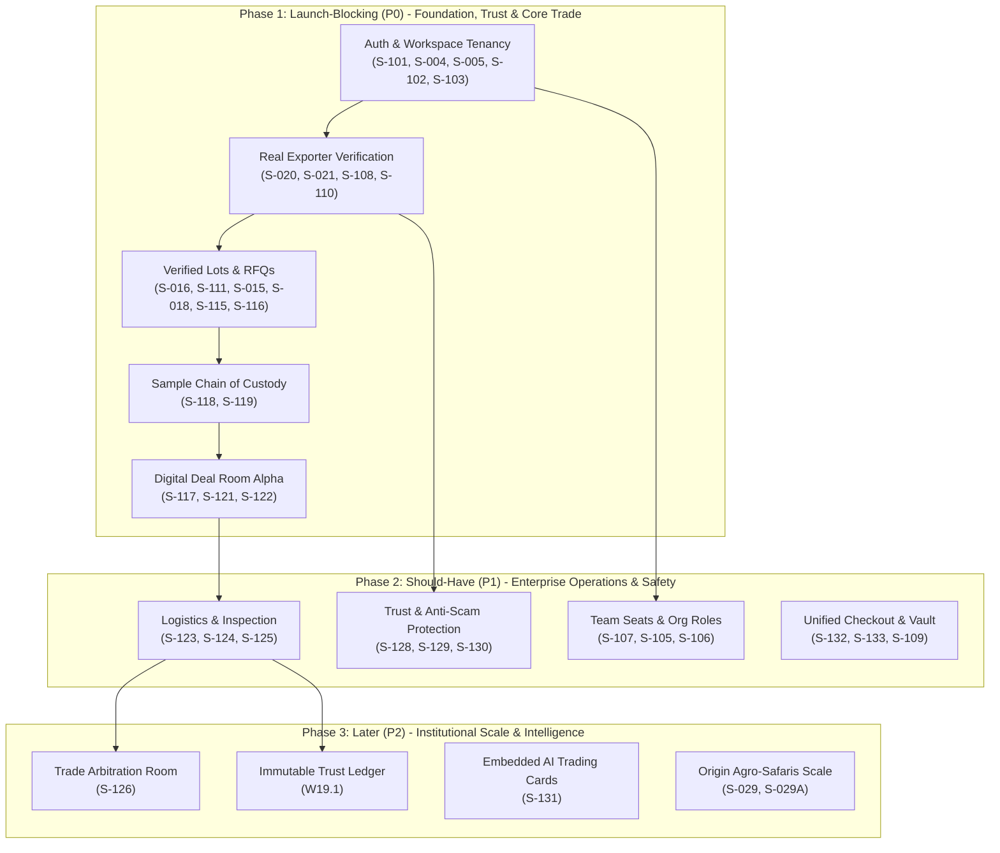

# Fira Link Mobile App: Engineering Build Order & Implementation Roadmap

**File Reference:** Part F of the Product Design & Engineering Architecture Specification  
**Methodology:** Dependency-Driven Iterative Milestones  

---

## 1. Implementation Tier Ranking

The development roadmap is strictly prioritized into three tiers to guarantee that core B2B trust, regulatory compliance, and revenue-generating workflows launch without technical debt.

---

## 2. Phase Breakdown & Deliverables

### Phase 1: Launch-Blocking (P0) — Foundation, Trust & Core Trade Loop

**Goal:** Establish a working end-to-end B2B trade transaction: Register -> Verify Exporter -> Publish Lab-Backed Lot -> Post RFQ -> Compare Quotes -> Order Sample -> E-Sign Contract in Deal Room.

| Priority | Screen ID & Name | Status | Dependencies | Core Objective |
| :---: | :--- | :---: | :--- | :--- |
| **P0-01** | `S-101` Initial Language Choice | `NEW` | None | Ethiopian bilingual support (English/Amharic) on cold launch. |
| **P0-02** | `S-004` Auth Screen & `S-005` OTP | `MODIFY` | `S-101` | Phone-first registration with SMS OTP activation. |
| **P0-03** | `S-102` Intent Selection & `S-103` Workspace | `NEW` | `S-005` | Adaptive onboarding into Personal vs Business workspaces. |
| **P0-04** | `S-108` Document Scanner & Camera Capture | `NEW` | Camera / File Picker | Replace hardcoded dummy byte upload with real camera/PDF vaulting. |
| **P0-05** | `S-021` Organization Verification Dossier | `MODIFY` | `S-108` | Real ECTA legal verification (Tier 1 compliance). |
| **P0-06** | `S-110` Public "Verify a Seller" Page | `NEW` | `S-021` | Anti-fraud public web/app verification lookup. |
| **P0-07** | `S-111` Evidence Level Selector | `NEW` | `S-108` | Classify lots: Claimed, Documented, Lab-Backed, Inspected. |
| **P0-08** | `S-016` Create Coffee Lot Screen | `MODIFY` | `S-111`, `S-021` | ECTA minimum price compliance check + GrainPro specs. |
| **P0-09** | `S-015` Coffee Lot Detail Screen | `MODIFY` | `S-016` | Render verified evidence badges, benchmark, and trust card. |
| **P0-10** | `S-019` Create Buyer RFQ Screen | `MODIFY` | `S-004` | Structured international procurement tenders. |
| **P0-11** | `S-116` Exporter Quotation Builder | `NEW` | `S-021` | Exporter bidding with ECTA price floor guardrails. |
| **P0-12** | `S-115` RFQ Quotation Comparison Table | `NEW` | `S-116` | Side-by-side bid comparison for roasters and buyers. |
| **P0-13** | `S-118` Sample Request Form | `NEW` | `S-015` | Courier sample ordering (DHL/FedEx account or fee). |
| **P0-14** | `S-119` Sample Tracking & Chain of Custody | `NEW` | `S-118` | Track physical sample parcel & sealed counter-sample hash. |
| **P0-15** | `S-117` Digital Deal Room Hub | `NEW` | `S-115`, `S-119` | Collaborative deal hub between buyer and exporter. |
| **P0-16** | `S-121` Export Contract & E-Signature | `NEW` | `S-117` | Dual legal e-signature on institutional sales contracts. |
| **P0-17** | `S-122` Payment Milestones & LC Tracker | `NEW` | `S-121` | Letter of Credit (LC) and SWIFT MT103 documentary proof. |

---

### Phase 2: Should-Have (P1) — Logistics, Safety & Enterprise Operations

**Goal:** Expand the deal closing lifecycle into dry mill inspection, shipping logistics, anti-scam security enforcement, and team seat management.

| Priority | Screen ID & Name | Status | Dependencies | Core Objective |
| :--- | :--- | :---: | :--- | :--- |
| **P1-01** | `S-123` Pre-Shipment Inspection & Stuffing | `NEW` | `S-122` | Mill moisture verification & container seal photo proof. |
| **P1-02** | `S-124` Shipping Logistics & Document Release | `NEW` | `S-123` | Addis-Djibouti transit, vessel tracking, and Bill of Lading release. |
| **P1-03** | `S-125` Trade Settlement & Closeout | `NEW` | `S-124` | Deal archive, mutual review, completed shipment counter update. |
| **P1-04** | `S-128` Report Listing or User Modal | `NEW` | `S-015`, `S-043` | User-driven reporting of fraudulent brokers or wire scams. |
| **P1-05** | `S-129` Off-Platform Scam Warning Sheet | `NEW` | `S-043` | Intercept off-platform wire solicitations in chat. |
| **P1-06** | `S-130` Suspended / Expired License State | `NEW` | `S-021` | Restrict non-compliant exporters while preserving open deals. |
| **P1-07** | `S-105` Workspace Switcher Modal | `NEW` | `S-035` | Multi-company switching between personal and business entities. |
| **P1-08** | `S-107` Team Seats & Member Roles | `NEW` | `S-105` | Invite exporter staff with role-based permissions (Owner/Staff). |
| **P1-09** | `S-132` Unified Checkout & CBE Slip Upload | `NEW` | `S-023` | Support Commercial Bank of Ethiopia offline deposit slips. |
| **P1-10** | `S-133` Compliance Document Vault | `NEW` | `S-035` | Central archive for all trade licenses with expiry countdowns. |
| **P1-11** | `S-109` Verification Audit Tracker | `NEW` | `S-021` | Transparent regulatory audit timeline and note resolution. |
| **P1-12** | `S-113` Lot Lifecycle Management | `NEW` | `S-020` | Lot pausing, 90-day renewal, and inventory decrementing. |
| **P1-13** | `S-114` Exporter Public Profile | `NEW` | `S-021` | Showcase completed shipments, facilities, and certifications. |

---

### Phase 3: Later (P2) — Institutional Scale, AI Intelligence & Safaris

**Goal:** Advanced institutional scale: binding trade arbitration, unforgeable trust ledgers, embedded AI trading tools, and agro-tourism expansions.

| Priority | Screen ID & Name | Status | Dependencies | Core Objective |
| :--- | :--- | :---: | :--- | :--- |
| **P2-01** | `S-126` Trade Dispute Resolution Room | `NEW` | `S-117` | Formal arbitration with retained sample laboratory cupping. |
| **P2-02** | `W19.1` Immutable Trust Score Ledger | `NEW` | `S-125` | Public cryptographic history of on-time delivery & quality records. |
| **P2-03** | `S-131` AI Calculation & Tool Result Card | `NEW` | `S-024` | Interactive calculation cards embedded in Gemini chat streams. |
| **P2-04** | `S-029A` Tour Itinerary & Agro-Safari Booking | `MODIFY` | `S-029` | Cupping masterclasses and farm immersion reservations. |
| **P2-05** | `S-008` Home 2 Code Deprecation | `REMOVE` | `S-007` | Clean up redundant legacy `/home2` routes. |

---

## 3. Critical Path Milestone Gates

Before progressing between phases, the following **Milestone Gates** must be certified:

### Gate 1: Trust & Tenancy Certification (Blocks Phase 2 Entry)
1. **Zero Mocked Uploads:** `S-021` and `S-108` upload real encrypted PDF/image files to non-public storage.
2. **Hard Constraint #1 Validated:** Automated test (`TrustIsNeverForSaleTest`) confirms no paid SaaS plan alters verification status or cupping scores.
3. **ECTA Price Guardrail:** No exporter can publish a lot or submit an RFQ quote below official daily minimum prices.

### Gate 2: Deal Room Integrity Certification (Blocks Phase 3 Entry)
1. **Invariant Rule 3 Validated:** Exporters with expired or downgraded SaaS subscriptions can still view, message, and execute milestones in open Deal Rooms.
2. **Sample Binding:** Approved sample seal hashes (`SEAL-ETH-...`) automatically populate the legal contract in `S-121`.
3. **Idempotent Webhooks:** Chapa and CBE offline payments verify transaction reference codes without race conditions.

