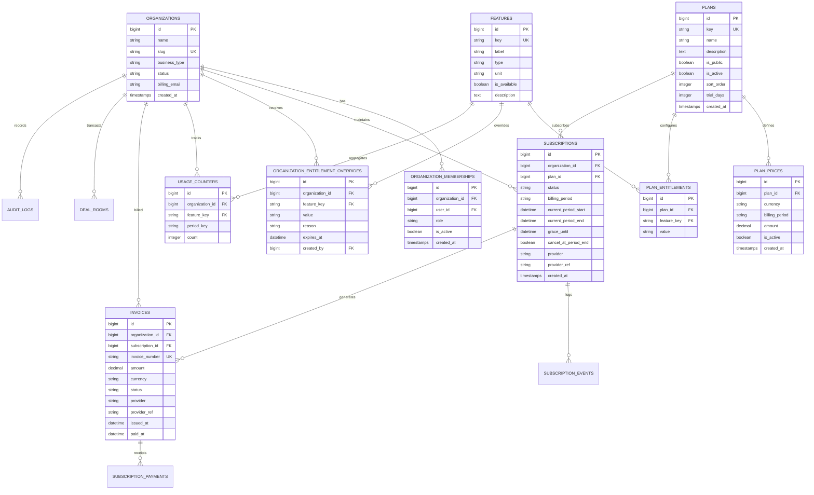
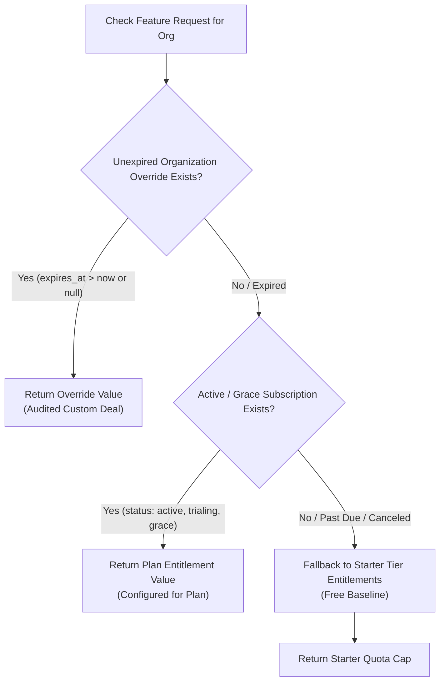
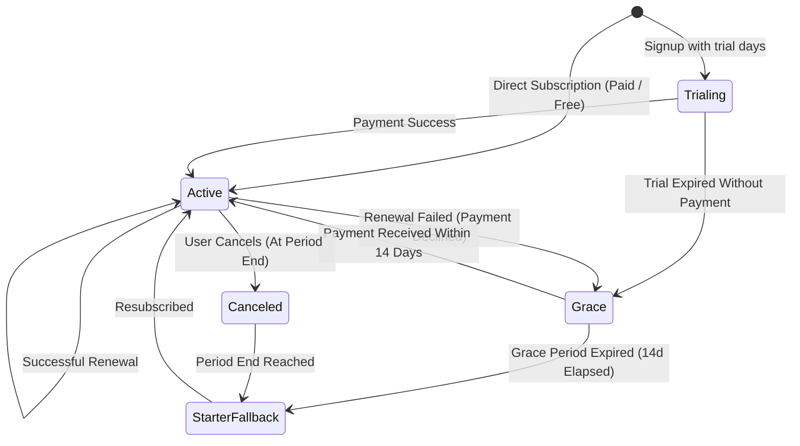

# Fira Link B2B SaaS Billing & Entitlement Architecture

**Version:** 1.0  
**Author:** Senior Laravel & SaaS Billing Architect  
**Platform:** Fira Link (Ethiopian B2B Green Coffee Export Platform)  
**Primary Brand Color:** `#6D1A95`

---

## 1. Executive Summary & Core Guarantees

The Fira Link SaaS Billing and Entitlement System transitions the platform from a hardcoded, single-user model into a multi-tenant, data-driven B2B SaaS architecture. All pricing, tier limits, feature flags, and commercial capabilities are modeled as **database records** rather than hardcoded logic. System administrators can alter plan prices, adjust quota caps, introduce new capabilities, and issue promotional overrides from the administrator portal without requiring code changes or application redeployments.

### Invariant Rules & Hard Constraints
1. **Trust is Never for Sale:** No commercial plan, price tier, or entitlement key may alter exporter verification tiers, approval outcomes or speed, lot evidence requirements, organic/specialty cupping scores, or trade record integrity. This rule is enforced by an automated guard test (`TrustIsNeverForSaleTest`) inspecting all registered capabilities.
2. **Separation of Permissions and Entitlements:**
   - **Permissions ("Who are you"):** Dictated by verified organization business types (`exporter`, `cooperative`, `commercial_farm`, `buyer`), verification tiers, and member roles (`owner`, `manager`, `staff`).
   - **Entitlements ("What did you pay for"):** Computed by `EntitlementService` based on active subscription plan quotas and time-bounded promotional overrides.
3. **Open Deals & Trade Records Never Expire on Downgrade:** When an exporter's subscription lapses or downgrades, live deal rooms, contracts, and dispute resolutions **always continue uninterrupted**. Trade records and legal export documents are never purged.
4. **Scope of Funds:** Fira Link collects subscription SaaS fees only. Deal transaction escrow or payment handling is excluded (licensing unconfirmed).

---

## 2. Entity-Relationship Data Model

---

## 3. Entitlement Resolution Hierarchy

The single source of truth for authorization is `App\Services\EntitlementService`. When `can(org, featureKey)` or `limit(org, featureKey)` is queried, the value is evaluated using strict precedence:

### Quota Evaluation Matrix
- **Numeric Limits (`type: limit`):**
  - `-1`: Unlimited quota (no cap enforced).
  - `0`: Capability disabled.
  - `> 0`: Capped. Consuming beyond the limit is atomically rejected with a `403` status and structured error `{code: "limit_reached", feature, limit, used, upgrade_url}`.
- **Booleans (`type: boolean`):**
  - Returns `true` only if value is truthy (`1`, `true`, `"1"`).
- **Tiers (`type: tier`):**
  - Resolves string identifier (e.g. `basic`, `full`, `custom`).

---

## 4. Enforcement Point Map

| Feature Key | Gated Action | Enforcement Layer | Failure Behavior |
| :--- | :--- | :--- | :--- |
| `active_lots` | Exporter publishes new lot or reactivates draft | `MarketplaceSellerController::storeListing` & `MarketplaceWebController::storeListing` | Returns `403` JSON or redirects to `/marketplace/pricing` with notice. |
| `rfq_responses_per_month` | Exporter submits quotation on buyer tender | `MarketplaceRfqController::submitQuote` | Returns `403` with `{code: "limit_reached", feature: "rfq_responses_per_month"}`. |
| `seats` | Org owner invites team member | `OrganizationMembershipController` | Blocks invitation if active member count equals or exceeds seat limit. |
| `active_deal_rooms` | Starting a commercial transaction room | `DealRoomController::create` | Blocks initiation if open deals exceed plan cap; open deals never cancelled. |
| `storage_gb` | Uploading shipping docs, BL, cupping certificates | `DocumentUploadService` | Blocks uploads exceeding storage quota; viewing & downloading existing files is always allowed. |
| `bulk_csv_lot_upload` | Spreadsheet batch import of coffee lots | `EnsureEntitlement:bulk_csv_lot_upload` | Middleware returns 403 / redirect to upgrade if boolean entitlement is 0. |
| `api_access` | Generating REST API keys and webhook integrations | `EnsureEntitlement:api_access` | Blocks API token creation for tiers below Business. |
| `audit_log_export` | Exporting compliance event logs to CSV | `EnsureEntitlement:audit_log_export` | Feature gated behind Business tier. |

---

## 5. Subscription Lifecycle & Downgrade State Machine

### Downgrade Reconciliation Rules (`EntitlementService::reconcileDowngrade`)
When an organization lapses to the Starter plan:
1. **Open Deals Continue Unaffected:** Any contract currently `active`, `under_contract`, or in milestone execution remains fully accessible. Open deals are never locked or cancelled.
2. **Trade Records & Invoices are Permanent:** All historical invoices, past deal logs, export documents, and laboratory cupping certificates remain readable and downloadable.
3. **Lot Deactivation (Not Deletion):** If an exporter has 12 active lots and lapses to Starter (limit 3), the oldest 9 lots are transitioned to `status: 'draft'`. No lots are deleted. The exporter may choose which 3 lots to activate from their dashboard.
4. **Member Seats Suspended:** Members beyond the 2-seat limit are flagged `is_active: false`. No account data or credentials are deleted.

---

## 6. Payment Gateways & Idempotency

### Supported Payment Channels
- **Chapa API:** Supports Ethiopian Birr (ETB) and USD. Powers instant Telebirr, CBE Birr, Awash Birr, and international Visa/Mastercard payments.
- **Offline / Bank Wire:** For cooperative unions and exporters requiring formal commercial proforma invoices and manual wire transfer verification.

### Webhook Idempotency Protocol
1. Incoming webhooks are received at `/billing/webhook/{provider}` (exempt from web CSRF).
2. The payload is checked for HMAC signature match (`hash_hmac('sha256', payload, secret)`).
3. An idempotency key is synthesized: `{provider}:{provider_ref}`.
4. The transaction checks `WebhookCall::where('idempotency_key', $key)`:
   - If already marked `processed`, the webhook immediately exits with `{success: true, duplicate: true}` without duplicate event firing.
   - If new, a `WebhookCall` audit record is persisted, the `Invoice` is marked `paid`, the `Subscription` is activated, and a `SubscriptionPayment` receipt is logged.

---

## 7. Runbook: Adding Features and Founding-Member Overrides

### How to Add a New Capability Without Deployment
1. Navigate to **Admin Dashboard &rarr; SaaS Billing &rarr; Feature Registry**.
2. Click **Register New Feature**.
3. Input:
   - **Key:** `new_feature_key` (stable slug).
   - **Label:** Human readable title.
   - **Type:** `limit` (numeric), `boolean` (toggle), or `tier` (string).
   - **Availability:** Mark *Available Now* or *Coming Soon*.
4. Navigate to **Plans & Entitlements** and set the limit for each plan. Click **Save Entitlements**.
5. All caching is automatically invalidated.

### How to Grant Founding-Member Promotional Deals
1. Navigate to **Admin Dashboard &rarr; SaaS Billing &rarr; Org Overrides**.
2. Click **Grant Entitlement Override**.
3. Select the target Organization (e.g., *Oromia Coffee Farmers Cooperative Union*).
4. Choose the feature key (e.g., `active_lots`).
5. Enter the override value (e.g., `50`).
6. Set expiration (e.g., 6 months from today).
7. Enter reason: `Founding Exporter Promotion (+50 lots, 6 months)`.
8. Click **Apply & Audit Override**. The override takes immediate precedence and is recorded in `audit_logs`.

